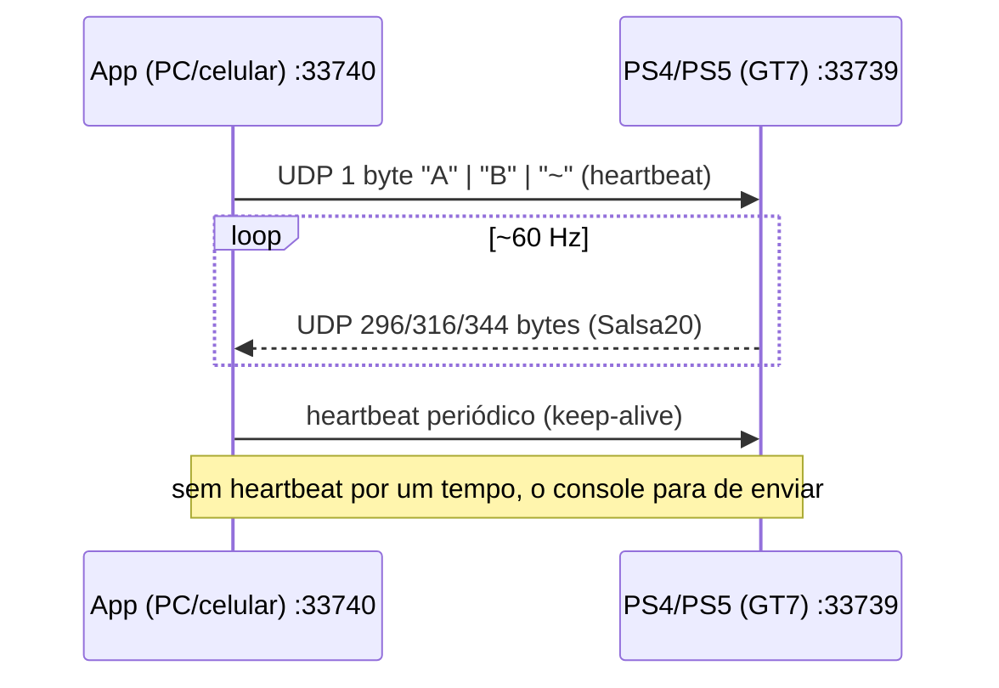

# Estudo: como funcionam os apps de telemetria do Gran Turismo 7 via LAN

> Pesquisa feita em 07/11/2026. O protocolo **não tem documentação oficial** da Polyphony Digital.
> Tudo o que se sabe vem de engenharia reversa da comunidade. As fontes principais são o
> [Nenkai/PDTools](https://github.com/Nenkai/PDTools) (referência mais confiável) e o
> [MacManley/gt7-udp](https://github.com/MacManley/gt7-udp). As fontes estão listadas no fim do documento.

---

## 1. Visão geral

Os apps de celular e PC que mostram dados do GT7 em tempo real (SimHub, Sim Dashboard, GT7 Dashboard,
datalogger etc.) usam o mesmo mecanismo. Ele se chama **Simulator Interface** e já existia no GT6 e no GT Sport:

1. O app envia um pacote UDP pequeno, chamado **heartbeat**, para o IP do PlayStation.
2. O console passa a mandar **~60 pacotes por segundo** de volta para o IP de origem do heartbeat.
3. Cada pacote vem **criptografado com Salsa20**. O app decifra, valida o "magic" e lê os campos por *offset* fixo.
4. Se o app parar de mandar heartbeats, o console para de transmitir.

Não existe pareamento, login nem descoberta automática oficial. O app só precisa saber o IP do console e
estar na mesma rede.



---

## 2. Camada de rede

| Item | GT7 | GT6 / GT Sport |
|---|---|---|
| Porta **no console** (destino do heartbeat) | **33739/UDP** | 33339/UDP |
| Porta **no app** (onde o app escuta) | **33740/UDP** | 33340/UDP |
| Transporte | UDP unicast | UDP unicast |
| Frequência | ~60 Hz (um pacote por frame de física) | — |

Detalhes práticos:

- **Use um único socket.** O app faz `bind` na porta 33740 e manda o heartbeat **pelo mesmo socket**.
  O PDTools faz exatamente isso (`new UdpClient(33740)` e depois envia para `consoleIP:33739`). O console
  responde ao IP que mandou o heartbeat, na porta 33740.
- **Descobrir o IP do console.** Quase todos os apps pedem o IP manualmente. Ele aparece no PS5 em
  *Configurações → Rede → Status da conexão*. Alguns apps tentam enviar o heartbeat para o endereço de
  broadcast da sub-rede e aprendem o IP pela origem da resposta. Isso **não é documentado** e depende do
  roteador, então trate como "tentativa automática" e deixe o campo manual como alternativa.
- **Um destino por vez.** O console transmite para quem mandou o heartbeat. Por isso existem projetos de
  *relay*, como o [gt7-telemetry-relay](https://github.com/ThrottleGeist/gt7-telemetry-relay), que recebem
  o fluxo uma vez e redistribuem para vários apps, inclusive em formatos diferentes. Se você quer
  celular + PC ao mesmo tempo, planeje um relay ou um "hub".
- **O primeiro formato "trava".** O tipo de pacote (A/B/~) é definido pelo primeiro heartbeat da sessão.
  Para trocar de formato, o console precisa ficar sem receber heartbeats por um tempo
  ([PDTools #14](https://github.com/Nenkai/PDTools/issues/14)).

### Problemas típicos de rede (o que mais gera suporte nesses apps)

| Problema | Causa | Solução |
|---|---|---|
| Nada chega no PC | Firewall do Windows bloqueando entrada UDP 33740 | Regra de entrada UDP 33740 (ou permitir o executável) |
| Nada chega no celular | Isolamento de clientes (AP isolation) / rede "convidado" / Wi-Fi mesh com VLAN | Mesma sub-rede, desligar isolamento |
| iOS não recebe | iOS 14+ exige permissão de **Rede Local** | `NSLocalNetworkUsageDescription` no Info.plist; para broadcast/multicast também o entitlement `com.apple.developer.networking.multicast` |
| Android para em segundo plano | Doze/otimização de bateria | Foreground service + `WifiLock` (`WIFI_MODE_FULL_HIGH_PERF`) |
| Pacotes "picotados" no Wi-Fi | Perda de UDP, economia de energia do Wi-Fi | Tolerar perda (usar `packetId`), console no cabo, 5 GHz |
| Dados param em menus/replay | Comportamento do jogo (veja flags e limitações) | Tratar como estado "sem dados" |

---

## 3. Heartbeat e tipos de pacote

O heartbeat é **1 byte ASCII**. O valor escolhe o formato do pacote:

| Heartbeat | Nome | Tamanho | XOR do nonce | Desde | Observações |
|---|---|---|---|---|---|
| `A` (0x41) | Pacote A (clássico) | **296** (0x128) | `0xDEADBEAF` | lançamento | Compatível com tudo |
| `B` (0x42) | Pacote B | **316** (0x13C) | `0xDEADBEEF` | update 1.42 | + volante, sway/heave/surge. Relatos de que **não funciona no Sport Mode online** |
| `~` (0x7E) | Pacote "til" | **344** (0x158) | `0x55FABB4F` | update 1.42 | + acelerador/freio "crus", energia recuperada. Relatado como indisponível em replays |
| `C` (0x43) | Pacote C | **368** (0x170) | `0xDEADBEEF` (só MacManley, não verificado no PDTools) | ~1.68 | + tipo de superfície, tempo da volta atual, entre-eixos, categoria |

**Cadência do heartbeat.** As fontes divergem:

- Documentação antiga da comunidade: "a cada 100 pacotes (~1,6 s)".
- README do MacManley: "a cada 1000 pacotes (~16 s)".
- PDTools: reenvia se passaram **mais de 10 s** desde o último.

**Recomendação:** mande um heartbeat **a cada ~1 s com timer próprio**, que não dependa da chegada de
pacotes. É barato (1 byte por segundo) e funciona em qualquer um dos cenários.

> Cuidado com um bug do PDTools: lá o heartbeat só é reenviado *depois* de um `ReceiveAsync` retornar.
> Se o fluxo para (console reiniciou, IP mudou), o loop fica bloqueado para sempre. Use um timer
> independente **e** um timeout de recepção (ex.: 2–3 s sem pacotes → estado "desconectado", mas continue
> mandando heartbeat).

---

## 4. Criptografia (Salsa20)

Todo pacote vem cifrado com **Salsa20/20** (o padrão, de 20 rodadas). Chave de 32 bytes, nonce de 8 bytes.

### 4.1 Chave

A string ASCII é `"Simulator Interface Packet GT7 ver 0.0"` (38 caracteres). O Salsa20 usa só os
**32 primeiros bytes**:

```
"Simulator Interface Packet GT7 v"
```

### 4.2 Nonce (IV) – derivado do próprio pacote

Os bytes **0x40–0x43** do pacote **não são cifrados**, ou seja, valem o mesmo antes e depois da decifragem.
Eles servem de semente:

```
iv1   = uint32_le(packet[0x40:0x44])      # lido do pacote AINDA cifrado
iv2   = iv1 XOR XOR_KEY                   # A: 0xDEADBEAF, B: 0xDEADBEEF, ~: 0x55FABB4F
nonce = le32(iv2) || le32(iv1)            # 8 bytes
plain = Salsa20(key32, nonce).decrypt(packet_inteiro)   # contador começa em 0
```

> Atenção: `0xDEADBEAF` (A) termina em **AF**, enquanto `0xDEADBEEF` (B) termina em **EF**. É um erro de
> digitação comum. Se o magic não bate, a primeira coisa a conferir é o XOR certo para o heartbeat enviado.

### 4.3 Validação (magic)

Depois de decifrar, `int32_le(plain[0x00:0x04])` deve ser **`0x47375330`** (bytes `30 53 37 47` = "0S7G").
Esse valor vale para GT7 e GT Sport. O GT6 usa `0x30533647` em big-endian (PS3).

Se o magic não bater, descarte o pacote. As causas possíveis são chave/XOR errado, tamanho inesperado ou
lixo na rede. Detecte o tipo do pacote **pelo tamanho do datagrama** (296/316/344/368), não só pelo
heartbeat enviado.

Essa "criptografia" não tem segurança real: a chave é fixa e conhecida. Na prática ela só obriga quem
quer ler os dados a conhecer o protocolo.

---

## 5. Layout do pacote (decifrado, little-endian)

Todos os floats são IEEE-754 de 32 bits. Os offsets estão em hexadecimal.

### 5.1 Pacote A – 296 bytes (base de todos os formatos)

| Offset | Tipo | Campo | Unidade / notas |
|---|---|---|---|
| 0x00 | int32 | magic | `0x47375330` |
| 0x04 | f32×3 | posição (x, y, z) | metros, coordenadas do mundo; **Y é "para cima"** |
| 0x10 | f32×3 | velocidade (x, y, z) | m/s, eixo do mundo |
| 0x1C | f32×3 | rotação (pitch, yaw, roll) | É interpretado como quaternion (x, y, z) |
| 0x28 | f32 | orientação relativa ao norte | 1.0 = norte, 0.0 = sul (= componente w do quaternion) |
| 0x2C | f32×3 | velocidade angular | rad/s |
| 0x38 | f32 | altura da carroceria | m |
| 0x3C | f32 | RPM do motor | |
| 0x40 | 4 bytes | **semente do IV** (não cifrada) | não é dado de telemetria |
| 0x44 | f32 | combustível atual | litros (ou % da bateria em EV) |
| 0x48 | f32 | capacidade do tanque | 100 em EV; **0 se não há consumo** |
| 0x4C | f32 | velocidade | **m/s** (× 3.6 = km/h) |
| 0x50 | f32 | turbo boost | valor − 1 = bar (1.0 = 0 kPa) |
| 0x54 | f32 | pressão do óleo | bar |
| 0x58 | f32 | temperatura da água | sempre 85 (fixo) |
| 0x5C | f32 | temperatura do óleo | sempre 110 (fixo) |
| 0x60 | f32×4 | temperatura de superfície dos pneus FL, FR, RL, RR | °C |
| 0x70 | int32 | **packetId** | incrementa a cada pacote. Use para detectar perda e duplicados |
| 0x74 | int16 | volta atual | 0 antes de cruzar a largada |
| 0x76 | int16 | total de voltas | 0 em time trial / livre |
| 0x78 | int32 | melhor volta | ms; −1 se não houver |
| 0x7C | int32 | última volta | ms; −1 se não houver |
| 0x80 | int32 | hora do dia na pista | ms |
| 0x84 | int16 | posição no grid / quali | −1 depois da largada |
| 0x86 | int16 | nº de carros pré-corrida | −1 depois da largada |
| 0x88 | int16 | RPM mínimo do alerta (shift light) | |
| 0x8A | int16 | RPM máximo do alerta (shift light) | |
| 0x8C | int16 | velocidade máxima calculada | km/h |
| 0x8E | int16 | **flags** (ver 5.4) | bitfield |
| 0x90 | u8 | **marcha** | nibble baixo = marcha atual; nibble alto = marcha sugerida (15 = nenhuma) |
| 0x91 | u8 | acelerador | 0–255 (valor **após** auxílios/TCS) |
| 0x92 | u8 | freio | 0–255 |
| 0x93 | u8 | (vazio) | |
| 0x94 | f32×3 | normal do plano da pista | vetor |
| 0xA0 | f32 | distância ao plano da pista | |
| 0xA4 | f32×4 | rotação das rodas FL, FR, RL, RR | **rad/s** (com sinal; use valor absoluto) |
| 0xB4 | f32×4 | raio dos pneus FL…RR | m |
| 0xC4 | f32×4 | altura da suspensão FL…RR | m |
| 0xD4 | 32 bytes | desconhecido / reservado | |
| 0xF4 | f32 | pedal de embreagem | 0–1 |
| 0xF8 | f32 | acoplamento da embreagem | 0–1 |
| 0xFC | f32 | RPM da embreagem → câmbio | |
| 0x100 | f32 | velocidade máxima da transmissão | relação |
| 0x104 | f32×7 | relações de marcha 1ª–7ª | |
| 0x120 | f32 | 8ª marcha ou vazio | O PDTools ignora; o MacManley trata como 8ª |
| 0x124 | int32 | **car code** (ID do carro) | cruzar com uma base de carros da comunidade para obter o nome |

### 5.2 Extras do pacote B (316 bytes = A + 20)

| Offset | Tipo | Campo | Notas |
|---|---|---|---|
| 0x128 | f32 | ângulo do volante | rad |
| 0x12C | f32 | velocidade angular do volante | rad/s (confirmado pela comunidade derivando 0x128) |
| 0x130 | f32 | sway (aceleração lateral) | para rigs de movimento |
| 0x134 | f32 | heave (vertical) | |
| 0x138 | f32 | surge (longitudinal) | |

### 5.3 Extras do pacote "~" (344 bytes = B + 28)

| Offset | Tipo | Campo | Notas |
|---|---|---|---|
| 0x13C | u8 | acelerador "cru" (input do piloto, antes dos filtros) | interpretação da comunidade |
| 0x13D | u8 | freio atuado | só em sessão ao vivo |
| 0x13E | u8 | desconhecido (0/2/4/9 conforme o carro) | |
| 0x13F | u8 | "sem consumo de combustível" / flag de recuperação de energia | 0 ou 1 |
| 0x140 | f32×4 | torque vectoring (por roda) | só alguns carros |
| 0x150 | f32 | energia recuperada (bateria) | híbridos/EV |
| 0x154 | f32 | desconhecido | |

### 5.4 Extras do pacote C (368 bytes = ~ + 24) — *menos verificado*

| Offset | Tipo | Campo | Notas |
|---|---|---|---|
| 0x158 | char×4 | tipo de superfície por roda | `T` asfalto, `C` zebra, `D` terra, `G` grama, `S` areia, `s` neve (as legendas divergem) |
| 0x15C | int32 | tempo da volta atual | ms (resolve o "timer" que os apps antigos precisavam estimar) |
| 0x160 | f32×2 | ângulo de esterço das rodas | |
| 0x168 | f32 | entre-eixos | m |
| 0x16C | char×4 | categoria do carro | |

### 5.5 Flags (int16 em 0x8E)

| Bit | Máscara | Significado |
|---|---|---|
| 0 | 0x0001 | Carro na pista |
| 1 | 0x0002 | Pausado (em online não fica pausado no menu) |
| 2 | 0x0004 | Carregando / processando |
| 3 | 0x0008 | Engatado (ainda pouco entendido) |
| 4 | 0x0010 | Tem turbo |
| 5 | 0x0020 | Alerta de limitador de giro piscando |
| 6 | 0x0040 | Freio de mão |
| 7 | 0x0080 | Faróis acesos |
| 8 | 0x0100 | Farol alto |
| 9 | 0x0200 | Farol baixo |
| 10 | 0x0400 | ASM (controle de estabilidade) ativo |
| 11 | 0x0800 | TCS (controle de tração) ativo |

---

## 6. O que os apps calculam por cima dos dados crus

O pacote é "baixo nível". Quase toda a "inteligência" dos apps vem de **dados derivados**:

| Recurso do app | Como é calculado |
|---|---|
| **Velocidade km/h / mph** | `speed_ms × 3.6` / `× 2.23694` |
| **Shift light** | Comparar o RPM com `minAlertRPM`/`maxAlertRPM` (0x88/0x8A) ou usar a flag de limitador |
| **Tempo da volta atual** (pacotes A/B/~) | Não existe no pacote. Conte pacotes desde a troca de `lapCount` e divida por 60, ou use o relógio local. Calibre com `lastLapTime` quando a volta fecha. O pacote C já traz o valor (0x15C) |
| **Delta para a melhor volta** | Gravar `(distância percorrida, tempo)` da melhor volta. A distância vem da integração de `speed × dt` ou do ponto mais próximo no traçado (x, z). Comparar em tempo real |
| **Mapa / traçado** | Plotar `position.x` × `position.z` (Y é altitude). Colorir por velocidade, freio ou marcha |
| **Identificação da pista** | **Não há track ID.** Os apps comparam o traçado gravado, ou o ponto de largada, com uma base de pistas conhecidas |
| **Nome do carro** | `carCode` (0x124) → tabela da comunidade (CSV de IDs) |
| **Consumo / estratégia** | Δ combustível por volta → voltas restantes = `fuel / consumoMédio` |
| **Slip ratio / patinagem** | `wheel_speed = |rps| × raio` vs. `speed`. Razão > 1 em tração = patinando; < 1 na frenagem = travando |
| **Força G** | Derivar a velocidade (0x10) ao longo do tempo e girar para o referencial do carro com a rotação, ou usar sway/surge/heave (pacote B+) |
| **Marcha** | `gear & 0x0F`; marcha sugerida `gear >> 4` (15 = nenhuma) |
| **Detectar sessão ativa** | Flags: `CarOnTrack` e não `Paused` / `Loading`. Usar também `packetId` mudando |
| **Gravar volta "limpa"** | Iniciar a gravação na troca de `lapCount`. Descartar se houve pausa ou se `packetId` pulou demais |

### Pipeline típico de um app

```
[Socket UDP :33740] → [Decifrar Salsa20] → [Validar magic + tamanho] → [Parse struct]
        ↑                                                                  │
 [Timer heartbeat 1 s]                                                     ▼
                                    [Estado: conectado? pista? pausado?] → [Derivados]
                                                                           │
                         ┌─────────────────────┬───────────────────────────┤
                         ▼                     ▼                           ▼
                 [UI tempo real 30–60 fps] [Gravador de voltas] [Relay/WebSocket p/ outros devices]
```

- **Threads.** Recepção e decifragem em uma thread/isolate dedicada. A UI consome o "último estado"
  (não precisa renderizar todos os 60 pacotes).
- **Arquitetura PC + celular.** Muitos dashboards web (ex.: GT7 Dashboard em Python) rodam no PC,
  recebem o UDP e servem uma página via HTTP/WebSocket que o celular abre no navegador. Isso contorna a
  limitação de "um destino" e as restrições do iOS.

---

## 7. Implementação de referência (Python)

Mínima, para validar o protocolo. Requer `pip install pycryptodome`.

```python
import socket, struct, time, threading
from Crypto.Cipher import Salsa20

PS_IP = "192.168.0.50"          # IP do PlayStation
SEND_PORT, RECV_PORT = 33739, 33740
KEY = b"Simulator Interface Packet GT7 ver 0.0"[:32]
XOR = {"A": 0xDEADBEAF, "B": 0xDEADBEEF, "~": 0x55FABB4F}
SIZE_TO_TYPE = {0x128: "A", 0x13C: "B", 0x158: "~"}
HEARTBEAT = "A"

sock = socket.socket(socket.AF_INET, socket.SOCK_DGRAM)
sock.bind(("0.0.0.0", RECV_PORT))
sock.settimeout(3.0)

def heartbeat_loop():
    while True:
        sock.sendto(HEARTBEAT.encode(), (PS_IP, SEND_PORT))
        time.sleep(1.0)

def decrypt(data: bytes) -> bytes | None:
    ptype = SIZE_TO_TYPE.get(len(data))
    if ptype is None:
        return None
    iv1 = struct.unpack_from("<I", data, 0x40)[0]
    iv2 = iv1 ^ XOR[ptype]
    nonce = struct.pack("<II", iv2, iv1)
    plain = Salsa20.new(key=KEY, nonce=nonce).decrypt(data)
    if struct.unpack_from("<i", plain, 0)[0] != 0x47375330:
        return None
    return plain

threading.Thread(target=heartbeat_loop, daemon=True).start()
last_id = None
while True:
    try:
        data, _ = sock.recvfrom(4096)
    except socket.timeout:
        print("sem dados... (console no menu? IP errado? firewall?)")
        continue
    p = decrypt(data)
    if p is None:
        continue
    pid = struct.unpack_from("<i", p, 0x70)[0]
    if last_id is not None and pid != last_id + 1:
        print(f"perda: {pid - last_id - 1} pacotes")
    last_id = pid
    rpm   = struct.unpack_from("<f", p, 0x3C)[0]
    kmh   = struct.unpack_from("<f", p, 0x4C)[0] * 3.6
    gear  = p[0x90] & 0x0F
    thr, brk = p[0x91], p[0x92]
    lap   = struct.unpack_from("<h", p, 0x74)[0]
    best, last = struct.unpack_from("<ii", p, 0x78)
    flags = struct.unpack_from("<H", p, 0x8E)[0]
    print(f"{kmh:6.1f} km/h  {rpm:6.0f} rpm  G{gear}  T{thr:3d} B{brk:3d}  "
          f"volta {lap}  best {best}ms  last {last}ms  flags {flags:#06x}")
```

O equivalente em outras stacks:

| Stack | Biblioteca Salsa20 | Observação |
|---|---|---|
| C# / .NET | Implementação própria (PDTools) ou BouncyCastle `Salsa20Engine` | O PDTools é a referência |
| Kotlin/Android | BouncyCastle `Salsa20Engine` | Foreground service para rodar em segundo plano |
| Swift/iOS | Implementação própria (~100 linhas) ou libsodium (`crypto_stream_salsa20`) | Permissão de rede local |
| Dart/Flutter | `pointycastle` (Salsa20Engine) + `RawDatagramSocket` | Bom para um app multiplataforma |
| Go | `golang.org/x/crypto/salsa20` | Veja vwhitteron/gt-telemetry |
| Node/TS | `@noble/ciphers` (salsa20) + `dgram` | Veja carlos-menezes/gran-turismo-query |
| ESP32 | MacManley/gt7-udp | Displays físicos / shift lights |

---

## 8. Limitações conhecidas

- **Não há dados de outros carros** (posições dos rivais, gaps). É só o seu carro.
- **Não há track ID, nome da pista nem setores.** Tudo isso tem que ser inferido.
- Temperaturas de água e óleo são **fixas** (85 / 110). Não existe desgaste de pneu nem temperatura de
  freio no pacote.
- Os pacotes B e ~ têm restrições relatadas em Sport Mode online e em replays. O **A é o mais compatível**.
- Em replays o fluxo continua (útil para análise), mas os inputs podem não refletir o piloto.
- Não é uma API oficial: um update do jogo pode mudar formatos. Isso já aconteceu, de forma aditiva, no
  1.42 e por volta do 1.68.

---

## 9. Pontos ainda incertos (para validar com o console real)

1. **Cadência mínima do heartbeat**: 1,6 s, 10 s ou 16 s? Mandar a cada 1 s evita a questão.
2. **XOR do pacote C** (`0xDEADBEEF`) e layout do C: vêm de uma única fonte (MacManley).
3. Codificação de **ré/neutro** no nibble de marcha: não documentada. Observe empiricamente.
4. Se `0x1C–0x28` é melhor tratado como quaternion (x, y, z, w) ou como pitch/yaw/roll + norte.
   O PDTools lê como quaternion.
5. Comportamento com **dois apps** mandando heartbeat: o mais provável é que o console siga o último
   remetente. Teste antes de depender de múltiplos clientes.
6. Descoberta por **broadcast**: funciona em algumas redes, não é garantida.

---

## Fontes

- [Nenkai/PDTools – PDTools.SimulatorInterface](https://github.com/Nenkai/PDTools/tree/master/PDTools.SimulatorInterface) (portas, heartbeat, layout, flags)
- [Nenkai/PDTools – SimulatorInterfaceCryptorGT7.cs](https://github.com/Nenkai/PDTools/tree/master/PDTools.Crypto/SimulationInterface) (chave, nonce, XOR)
- [Nenkai/PDTools issue #14 – formato "B"](https://github.com/Nenkai/PDTools/issues/14) (B/~, XOR 0x55FABB4F, interpretação dos campos extras)
- [MacManley/gt7-udp](https://github.com/MacManley/gt7-udp) (parser ESP32, pacote C, cadência de heartbeat)
- [SimHub issue #2254 – pacotes estendidos](https://github.com/SHWotever/SimHub/issues/2254)
- [RaceCrewAI/gt-telem](https://github.com/RaceCrewAI/gt-telem) (Python)
- [vwhitteron/gt-telemetry](https://pkg.go.dev/github.com/vwhitteron/gt-telemetry) (Go)
- [carlos-menezes/gran-turismo-query](https://github.com/carlos-menezes/gran-turismo-query) (TypeScript)
- [ThrottleGeist/gt7-telemetry-relay](https://github.com/ThrottleGeist/gt7-telemetry-relay) (relay multi-app)
- [jbhoorasingh/gt7-datalogger](https://github.com/jbhoorasingh/gt7-datalogger) (exemplo de app completo)
- [GTPlanet – Overview of GT7 Telemetry Software](https://www.gtplanet.net/forum/threads/overview-of-gt7-telemetry-software.418011/page-9)
