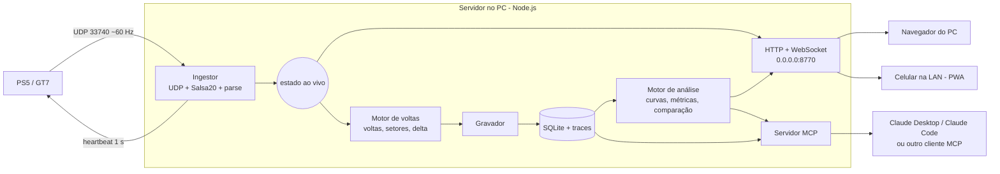

# Plano do app: GT7 Race Engineer

> Objetivo principal: **evoluir a pilotagem**. Saber onde se perde tempo, por quê (frenagem, traçado,
> aceleração) e o que fazer diferente. O painel ao vivo é o meio; a análise e o coach de IA são o fim.
>
> Base técnica do protocolo: [ESTUDO-TELEMETRIA-GT7.md](ESTUDO-TELEMETRIA-GT7.md).

---

## 1. Requisitos (o que você pediu)

| # | Requisito | Como o app resolve |
|---|---|---|
| R1 | Painel ao vivo, estilo piloto real: tempo de volta, delta, setores | Dashboard web em tempo real (WebSocket, 30–60 Hz) |
| R2 | Comparar suas voltas com as do top do ranking mundial | "Modo captura de replay": grava a volta do replay como **volta de referência** |
| R3 | Enviar todos os dados para IA via **MCP** | Servidor MCP com ferramentas de consulta e comparação por curva |
| R4 | Painel acessível no celular pela LAN (`http://192.168.x.x:PORTA`) | Servidor HTTP em `0.0.0.0`, PWA em tela cheia, QR code no PC |
| R5 | IA dizer "frea mais tarde", "acelera mais cedo", "mais trail braking", "traçado errado" | Motor de análise que transforma 60 Hz de dados em **métricas por curva**, que é o que a IA lê |

---

## 2. Arquitetura

Um único **processo servidor no PC** concentra tudo. Isso resolve a limitação do GT7 de mandar dados para
um destino só: o PC recebe o UDP uma vez e redistribui para quantos navegadores quiser.



### Componentes

1. **Ingestor**
   - Socket UDP na porta 33740 e heartbeat por timer de 1 s.
   - Decifra, valida magic e tamanho, faz o parse.
   - Formato do pacote **configurável**:
     - **Ao vivo:** `~`, ou `C` se ele funcionar, para ter acelerador/freio crus, volante e superfície.
     - **Replay:** `B`, porque o `~` não funciona em replay.
   - Troca de formato com *cooldown*: para os heartbeats, espera e manda o novo.
   - Detecta estado: desconectado / menu / pista / pausado / replay.

2. **Motor de voltas**
   - Detecta a troca de `lapCount`.
   - Cronometra pela contagem de pacotes (60 Hz) e **calibra** com `lastLapTime` quando a volta fecha.
   - Setores, delta ao vivo e volta prevista.

3. **Gravador**
   - Salva **todo pacote decifrado** da sessão, em binário compactado (~20 KB/s).
   - Isso permite reprocessar tudo depois, quando a análise melhorar.
   - Também serve para desenvolver sem o console (ver 2.1).

4. **Motor de análise**
   - Alinha voltas por distância.
   - Detecta curvas automaticamente.
   - Calcula as métricas por curva (seção 5).

5. **Servidor web**
   - Serve o dashboard e a página de análise.
   - Faz push do estado ao vivo por WebSocket.

6. **Servidor MCP**
   - Expõe sessões, voltas, comparações e métricas para a IA (seção 6).

### 2.1 Modo simulador (essencial para desenvolver)

Um "**console falso**" relê uma sessão gravada e reenvia os pacotes **cifrados**, no mesmo formato, para
o ingestor. Com isso dá para:

- desenvolver e testar a UI e a análise sem ligar o PS5;
- criar testes automatizados com sessões reais;
- reproduzir bugs ("naquela volta o delta ficou maluco").

---

## 3. Painel ao vivo (R1 + R4)

Layout pensado para ser lido **de relance**, em paisagem no celular ou no monitor:

```
┌───────────────────────────────────────────────────────────────┐
│  ●●●●●●●●○○○○  (shift lights)                    VOLTA 5/10   │
│                                                               │
│   −0.384          1:42.617           4         187 km/h       │
│   DELTA (vs ref)  PREVISTA          MARCHA                    │
│   ████████▌────── (barra de delta)                            │
│                                                               │
│  S1 31.204 ■     S2 38.911 ■     S3 --.---    ÚLTIMA 1:43.002 │
│  (roxo = melhor absoluto, verde = melhor pessoal, amarelo)    │
│                                                               │
│  [mini-mapa com posição]   ACEL ▮▮▮▮▮▯  FREIO ▮▯▯▯▯▯          │
│  Pneus 78 81 / 74 76 °C    Comb. 6.2 voltas                   │
└───────────────────────────────────────────────────────────────┘
```

- **Delta ao vivo** com referência escolhível: sua melhor volta, a melhor da sessão ou **uma volta do top
  capturada de replay**. Esse é o número mais útil para aprender.
- **Setores.** O GT7 não fornece setores, então o app cria:
  - automático: 3 setores de mesmo comprimento;
  - ou "portais" (linhas no mapa) definidos por você na página da pista.
- **Microssetores** (opcional): ~20–30 trechos por volta, coloridos no mapa. Mostram exatamente onde você
  ganha e onde perde.
- **Várias telas, trocadas por gesto.** O catálogo completo está na seção 3.1.

### 3.1 Telas e navegação por gestos

#### Catálogo de telas

Cada tela é uma "página" em tela cheia, desenhada para ser lida de relance:

| Tela | Conteúdo |
|---|---|
| **Corrida** (padrão) | Delta, volta atual/prevista/última/melhor, setores coloridos, marcha, velocidade, shift lights |
| **Delta grande** | Só o delta, enorme, e a barra de delta (o fundo muda de cor: verde ganhando, vermelho perdendo). Legível a 2–3 m da TV |
| **Pneus** | Os 4 pneus no desenho do carro. Por roda: temperatura (cor fria → ideal → quente), patinagem/travamento ao vivo, altura da suspensão. Superfície (asfalto/zebra/grama) se o pacote C funcionar. Histórico de temperatura da volta |
| **Inputs** | Barras de acelerador, freio e embreagem, ângulo do volante (pacote B+). Gráfico rolante dos últimos ~10 s. Indicadores de TCS/ASM atuando |
| **Motor e câmbio** | RPM grande com shift lights, marcha atual e sugerida, turbo, pressão do óleo, relações de marcha |
| **Mapa** | Traçado da pista com a sua posição, colorido por delta (microssetores). Próximo ponto de frenagem da referência |
| **Tempos** | Tabela de voltas e setores da sessão, melhores pessoais, volta ideal teórica, consistência |
| **Combustível / energia** | Consumo médio por volta, voltas restantes, combustível necessário até o fim; energia recuperada em híbridos/EV |
| **Forças G** | Círculo de G (lateral × longitudinal) com rastro, heave (pacote B+) |
| **Treino de curva** | A próxima curva com as metas da referência (frenagem, V-min, retomada) e o resultado da última passagem |
| **Personalizada** | Grade de widgets montada por você, por exemplo delta + pneus + combustível numa tela só |

#### Gestos

| Gesto | Ação |
|---|---|
| **Deslizar para a esquerda / direita** | Próxima / tela anterior (carrossel circular, com pontinhos indicando a posição) |
| **Toque** | Mostra por 3 s um cabeçalho com o nome da tela e a referência do delta |
| **Toque duplo** | Alterna a referência do delta: melhor pessoal → melhor da sessão → top capturado |
| **Pressionar e segurar** | Abre o seletor de telas: lista com miniaturas para pular direto, ligar/desligar e reordenar telas |
| **Pinça (só no Mapa)** | Zoom no traçado |
| **Botão de cadeado** | **Trava os gestos**, para que toques acidentais não troquem a tela com o celular montado no suporte. Destrava com pressão longa |

- **Cada dispositivo tem a sua configuração.** Quais telas, em que ordem e qual é a inicial. O celular
  pode mostrar Delta grande + Pneus, enquanto o PC mostra Mapa + Inputs. O app salva no servidor por
  dispositivo, então a configuração não se perde se o navegador limpar dados.
- **Controle remoto pelo PC** (opcional): escolher no PC qual tela o celular mostra, sem tocar nele.
- **Pop-ups automáticos**, que podem ser desligados. Ao fechar uma volta, aparece por 5 s um cartão com
  o tempo, o delta e o melhor setor, e depois a tela volta. **Nunca** troca de tela sozinho no meio da volta.
- **Ideia a testar: trocar de tela sem tirar a mão do volante.** O pacote traz a flag de farol alto.
  Piscar o farol alto duas vezes rápido poderia significar "próxima tela". Só funciona em carros/eventos
  em que o farol pode ser acionado, e precisa ser testado no console.
- **Implementação:**
  - CSS *scroll-snap* para o deslizar (nativo e suave no iOS e no Android) mais Pointer Events para
    toque duplo e pressão longa.
  - Vibração ao trocar de tela (`navigator.vibrate`) só no Android; o Safari no iOS não suporta.
  - **Só a tela visível é renderizada a 30–60 fps.** As vizinhas ficam pausadas, para poupar bateria e
    manter o celular frio.

### Acesso no celular

- O servidor escuta em `0.0.0.0:8770`. A tela do PC mostra a URL da LAN e um **QR code**.
- Na primeira execução, o app cria uma regra de entrada TCP 8770 no **Firewall do Windows** (com o seu
  consentimento) ou mostra o comando para criar.
- **PWA.** No celular, "Adicionar à tela inicial" abre em tela cheia, em paisagem e sem barra do navegador.
- **Tela sempre ligada.** A Wake Lock API só funciona em HTTPS, e `http://192.168…` não é seguro para o
  navegador. Opções:
  - (a) HTTPS local com certificado próprio (mkcert). Mais trabalhoso no iPhone.
  - (b) O truque do vídeo invisível em loop (estilo NoSleep).
  - (c) Instruir a desligar o bloqueio automático.
  - Começamos com (b) + (c) e deixamos (a) opcional.
- **Vários clientes ao mesmo tempo** (PC + celular + tablet) sem custo extra, já que o UDP chega só no PC.

---

## 4. Voltas de referência do top mundial (R2)

### Fluxo de captura

1. Você abre o replay do líder no ranking do Time Trial, no jogo.
2. No app: **"Capturar referência"**, informando piloto, carro e pista. O app troca para o formato `B`.
3. Você assiste a volta em **velocidade 1×, sem avançar ou pular**. O app grava.
4. O app valida a volta:
   - distância e formato batem com a pista;
   - não houve saltos de `packetId`;
   - o tempo bate com o tempo do ranking que você digitou.
5. A volta vira **referência**, disponível para o delta ao vivo, para a análise e para a IA.

### Limitações (honestas)

- **Dados de replay são suavizados.** O combustível não é confiável, e entradas como o freio podem ser
  interpoladas. Pontos de frenagem e velocidades devem ter precisão de alguns metros: suficiente para
  coaching, não para contar milissegundos.
- **Carro focado.** Ainda é preciso confirmar que, com vários carros no replay, os dados seguem o carro
  em foco. No Time Trial normalmente só existe um carro, então o problema praticamente some.
- **Compare maçã com maçã.** Use o mesmo carro, o mesmo acerto (se for fixo) e o mesmo tipo de pneu. O
  app avisa se o `carCode` for diferente.
- O piloto do top pode usar volante e outros auxílios. A comparação de *inputs* precisa considerar isso,
  mas traçado, pontos de frenagem e velocidades mínimas continuam valendo.

---

## 5. Motor de análise: o coração do coaching (R5)

A IA **não deve receber 60 Hz crus**: é caro, lento e ela se perde. O app pré-processa os dados em
métricas de piloto, curva a curva, como um engenheiro de pista faria.

### 5.1 Pipeline

1. **Linha de referência da pista.** É construída a partir de uma volta limpa (posição x, z).
2. **Alinhamento por distância.** Cada amostra de qualquer volta é projetada na linha de referência e
   ganha uma "distância na volta" em metros. Assim, voltas diferentes ficam comparáveis ponto a ponto.
3. **Detecção de curvas.**
   - Combina a curvatura do traçado, a taxa de guinada (yaw rate) e os mínimos locais de velocidade.
   - O resultado é T1, T2, … com entrada, ápice e saída.
   - Você pode renomear as curvas ("Eau Rouge") e ajustar os limites.
4. **Delta acumulado por distância.** Mostra exatamente onde o tempo é ganho ou perdido.

### 5.2 Métricas por curva

| Métrica | Como detectar | Que conselho gera |
|---|---|---|
| **Ponto de frenagem** | Distância em que o freio passa de ~5% | "Você freia 18 m antes da referência na T1" |
| **Pico e perfil de frenagem** | Máximo do freio, tempo até o pico | "Pisa no freio devagar; a referência crava 100% de cara" |
| **Trail braking** | Freio ainda aplicado durante a entrada (volante girando / guinada crescendo): duração e área da sobreposição | "Você solta o freio antes de virar; leve freio até perto do ápice" |
| **Velocidade mínima (V-min) e local** | Mínimo de velocidade na curva | "Sua V-min é 9 km/h menor; está freando demais" |
| **Ápice** | Local da V-min / ponto mais interno | "Seu ápice está 12 m antes: você está tangenciando cedo" |
| **Retomada do acelerador** | Distância em que o acelerador passa de ~10% e tempo até 100% | "Você acelera 25 m depois da referência" |
| **Coasting** | Tempo sem freio e sem acelerador | "0,6 s em roda livre na T4; é tempo perdido" |
| **Velocidade de saída** | Velocidade X m após a saída | "Saída 6 km/h mais lenta: custa tempo em toda a reta" |
| **Marcha no ápice** | `gear` na V-min | "A referência faz a T3 em 3ª, você em 2ª" |
| **Traçado** | Desvio lateral (m) vs linha da referência na entrada, no ápice e na saída | "Na entrada você está 2 m mais para dentro: abra mais" |
| **Patinagem na saída** | Slip das rodas traseiras (rotação × raio vs velocidade) e flag de TCS | "Roda patinando na saída: dose o acelerador" |
| **Travamento** | Slip das dianteiras na frenagem | "Travando a dianteira na T1" |
| **Correções de volante** | Inversões do ângulo do volante (pacote B+) | "Muita correção: carro saindo de traseira na entrada" |
| **Tempo ganho/perdido** | Variação do delta entre entrada e saída da curva | Prioriza as 3 curvas que mais custam |
| **Consistência** | Desvio-padrão das métricas entre as suas voltas | "Seu ponto de frenagem na T6 varia 15 m: falta referência visual" |

### 5.3 Visualizações da página de análise

- **Sobreposição de traces por distância:** velocidade, acelerador, freio, marcha, volante e delta, com
  duas ou mais voltas.
- **Mapa da pista colorido por delta** (verde ganha / vermelho perde), com os traçados das duas voltas
  sobrepostos e zoom por curva.
- **Tabela de curvas** com todas as métricas e diferenças.
- **Volta teórica ideal:** soma dos melhores microssetores.

---

## 6. Servidor MCP (R3)

### 6.1 Ferramentas (tools)

| Tool | O que retorna |
|---|---|
| `list_sessions` | Sessões: data, pista, carro, nº de voltas, melhor tempo |
| `list_laps(session_id)` | Voltas: tempo, setores, válida/inválida, marcação de referência |
| `list_reference_laps(track?)` | Voltas do top capturadas (piloto, carro, tempo) |
| `get_lap_summary(lap_id)` | Tempos, setores e resumo por curva |
| `compare_laps(lap_a, lap_b)` | **Tabela curva a curva** com diferenças de todas as métricas e tempo ganho/perdido. É a principal |
| `get_corner_detail(lap_ids, corner)` | Traces reamostrados (ex.: a cada 5 m) só daquela curva, para a IA "olhar de perto" |
| `get_consistency(session_id)` | Variação das métricas entre as voltas |
| `get_trace(lap_id, channels, from_m, to_m, step_m)` | Dados brutos sob demanda, sempre reamostrados e limitados |
| `render_comparison_chart(lap_a, lap_b, corner?)` | **Imagem PNG** do gráfico de traces e do mapa. O modelo consegue ler a imagem |
| `get_live_state` | Estado ao vivo (para perguntas durante a sessão) |

### 6.2 Prompts MCP prontos

- **"Debrief de sessão"**
  1. Compara a melhor volta com a referência do top.
  2. Lista as 3 curvas que mais custam tempo.
  3. Para cada uma, dá um diagnóstico com números e **uma** ação concreta para a próxima saída.
- **"Foco em curva"**: análise profunda de uma curva entre várias voltas.
- **"Plano de treino"**: sugere o que treinar nas próximas sessões com base no histórico.

### 6.3 Transporte

- **stdio**: o Claude Desktop/Code inicia o processo MCP, que lê o mesmo banco SQLite. Mais simples.
- **Streamable HTTP** em `/mcp` no próprio servidor: necessário para `get_live_state`.

Começamos com stdio e adicionamos HTTP depois.

### 6.4 Coach dentro do app (sugestão, fase posterior)

O MCP funciona com qualquer cliente. Além dele, um botão **"Debrief com IA"** na própria página de
análise pode chamar a API do Claude usando **as mesmas ferramentas**, mostrando o relatório ao lado dos
gráficos. Assim você não precisa sair do app.

---

## 7. Sugestões extras para aprender a pilotar

1. **Uma coisa de cada vez.** O coach deve dar **uma** instrução por curva por stint ("na T1, freie no
   marco de 100 m"). É assim que instrutores de pilotagem trabalham.
2. **Modo treino de curva.** Você escolhe uma curva. Ao passar por ela, o painel mostra só as suas
   métricas contra a referência (ponto de frenagem, V-min, saída) e um **aviso sonoro** no celular
   (TTS: "frenagem 10 metros cedo").
3. **Pontos de frenagem visuais.** Converter a distância da frenagem da referência em algo que você vê na
   pista ("placa de 100 m", "início da zebra"). Você anota isso no app por curva.
4. **Histórico de evolução.** Gráfico das suas métricas ao longo de dias ("ponto de frenagem na T1 foi
   de −25 m para −6 m vs top"). Isso motiva e mostra o que funcionou.
5. **Validação de volta.** Marcar voltas com corte de pista / saída. Superfície do pacote C, se ele
   funcionar, ou desvio grande da linha.
6. **Exportar para MoTeC i2** (opcional). É o padrão do automobilismo, se um dia quiser análise
   profissional.
7. **Assistências.** Registrar ASM/TCS ativos (flags) e sugerir desligar aos poucos à medida que a
   consistência melhora.

---

## 8. Stack recomendada

| Camada | Escolha | Por quê |
|---|---|---|
| Linguagem | **TypeScript** de ponta a ponta | Uma linguagem só para servidor, UI e MCP; tipos compartilhados para o formato do pacote |
| Runtime | Node.js 24 LTS | `dgram` para UDP, maduro, LTS atual |
| Monorepo | npm workspaces (npm 11, já instalado) | Pacotes compartilhando tipos, sem ferramenta extra |
| Salsa20 | `@noble/ciphers` | Puro JS, auditado, sem dependência nativa |
| Servidor | Fastify + `ws` | Leve e rápido |
| Frontend | **React + Vite + PWA** (`vite-plugin-pwa`) | Maior ecossistema e mais exemplos. Os valores de 60 Hz **não passam pelo estado do React** (ver abaixo) |
| Estado da UI | Zustand (configuração, telas, preferências) + store externo com `requestAnimationFrame` para a telemetria ao vivo | A UI re-renderiza só quando a configuração muda; os números ao vivo são desenhados direto |
| Carrossel / gestos | CSS scroll-snap + Pointer Events (sem biblioteca); Embla Carousel como plano B | Nativo e suave no iOS/Android |
| Gráficos | **uPlot** (traces de alta frequência) + Canvas 2D (mapa, pneus, círculo G, shift lights) | Desenha dezenas de milhares de pontos a 60 fps |
| Banco | SQLite nativo do Node (`node:sqlite`) para metadados, arquivos binários compactados (gzip) para os traces | Local, sem compilação nativa no Windows, fácil de copiar |
| MCP | `@modelcontextprotocol/sdk` (oficial) + `zod` | stdio + Streamable HTTP; os schemas do zod validam a entrada das tools |
| Testes | Vitest + sessões gravadas pelo simulador | Testes com dados reais sem console |
| Qualidade | TypeScript `strict` + Biome (lint/format) | Uma ferramenta só, rápida |
| Distribuição | Começa com `pnpm start` + navegador; depois um executável único com ícone na bandeja do Windows | Sem Electron: o PC usa o navegador, igual ao celular |

**Alternativa: Python** (FastAPI + numpy/pandas + MCP Python SDK). É melhor para análise numérica, mas
deixa o projeto com duas linguagens (Python no backend, JS na UI). A análise aqui é simples o suficiente
para TypeScript.

### Estrutura sugerida

```
gt7/
  packages/
    protocol/    # decifrar, parse, tipos (pacotes A/B/~/C), simulador de console
    core/        # motor de voltas, setores, delta, gravador, análise
    server/      # HTTP + WebSocket + QR + firewall helper
    mcp/         # servidor MCP (stdio + HTTP)
    web/         # dashboard ao vivo + página de análise (PWA)
  data/          # sessions.db + traces (fora do git)
```

---

## 9. Fases (entregas incrementais)

| Fase | Entrega | Pronto quando |
|---|---|---|
| **F0 – Fundação** | `protocol`: decifrar/parse A/B/~/C, gravador de sessão, simulador de console | Grava uma sessão real e o simulador a reproduz idêntica |
| **F1 – Painel ao vivo** | Dashboard PC + celular (LAN, QR, PWA) com carrossel por gestos, cadeado e seletor de telas. Telas: Corrida, Delta grande, Pneus, Inputs, Motor e câmbio. Delta vs melhor volta, 3 setores | Você pilota trocando de tela no celular com um deslizar |
| **F2 – Voltas e análise** | Banco de sessões, identificação da pista, alinhamento por distância, detecção de curvas, página de análise com sobreposição | Compara duas voltas suas curva a curva |
| **F3 – Referências do top** | Modo captura de replay, validação, delta ao vivo vs top | Delta ao vivo contra o líder do ranking |
| **F4 – MCP + coach** | Servidor MCP, tools da seção 6, prompts de debrief, gráfico em imagem | O Claude dá um debrief com números e ações concretas |
| **F5 – Extras** | Telas Mapa, Tempos, Combustível, Forças G, Treino de curva e Personalizada; microssetores, volta ideal, modo treino com áudio, histórico de evolução, controle remoto de telas, gesto pelo farol alto, MoTeC | — |

**Primeiro teste com o console (na F0):**

- confirmar a cadência do heartbeat;
- confirmar se o pacote C funciona;
- confirmar o comportamento em replay (carro focado, suavização);
- confirmar a codificação de ré/neutro.

Essas respostas definem detalhes das fases seguintes.

---

## 10. Riscos

| Risco | Mitigação |
|---|---|
| Update do GT7 muda o formato | O parser detecta pelo tamanho; o simulador e os testes pegam a regressão rápido |
| Replay suavizado deixa a referência imprecisa | Mostrar a margem de erro; focar a comparação em tendências (metros, km/h), não em milissegundos |
| Pista sem ID gera confusão de pistas | Identificar por impressão digital (largada + comprimento + forma) e confirmar com você na primeira vez |
| Wi-Fi perde pacotes | Interpolar lacunas curtas, marcar volta como "dados incompletos" acima de um limite |
| IA "inventa" conselhos | Ela só recebe métricas calculadas e o prompt exige citar os números; nada de dados crus sem contexto |
