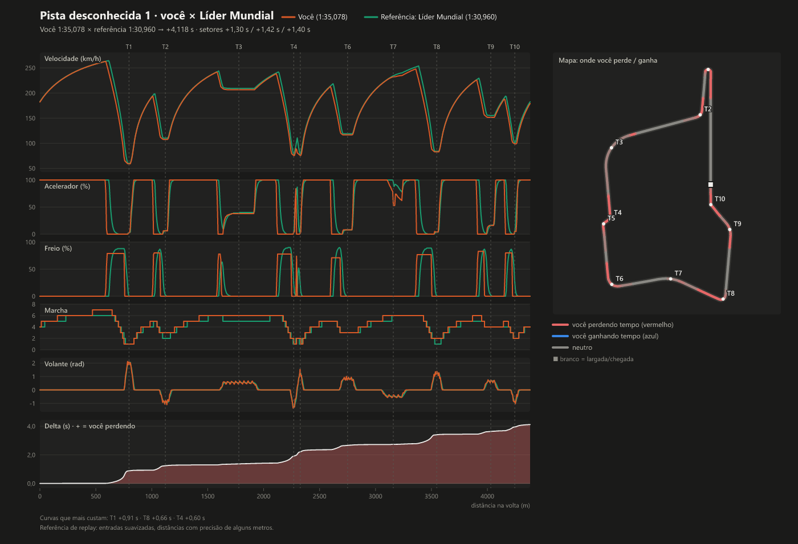
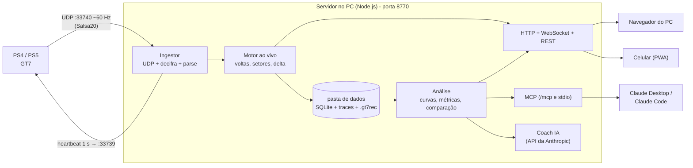

# Bono Engineer

Seu engenheiro de pista no sim racing, com telemetria, rádio e análise de voltas.
A integração disponível hoje é **Gran Turismo 7** no PlayStation. O Bono recebe os
dados pela rede local, mostra um painel ao vivo no PC e no celular, e depois da sessão diz
**onde você perde tempo, por quê e o que fazer diferente**, curva a curva. Também consegue capturar a volta de
um piloto do topo do ranking (pelo replay do Time Trial) para você comparar e usar como alvo.

Veja a [identidade do Bono Engineer e o plano multissimulação](docs/bono-engineer.md).

> Projeto pessoal, sem relação com a Polyphony Digital. O protocolo de telemetria do GT7 não tem
> documentação oficial; tudo vem de engenharia reversa da comunidade (veja o [estudo](ESTUDO-TELEMETRIA-GT7.md)).
> **Status:** tudo foi desenvolvido e testado com dados sintéticos. A primeira sessão com um console real
> ainda não aconteceu: use o roteiro [docs/primeiro-teste-com-ps5.md](docs/primeiro-teste-com-ps5.md).

## O que o app faz

- **Painel ao vivo** (PC e celular, ao mesmo tempo): delta contra a referência, tempos, setores, pneus,
  inputs, motor, mapa, combustível, forças G e mais. **11 telas** trocadas por gestos, em tela cheia, pensadas
  para serem lidas de relance.
- **Análise curva a curva**: sobreposição de gráficos (velocidade, acelerador, freio, marcha, volante e delta
  acumulado) por distância, mapa colorido por ganho/perda, tabela de curvas e uma lista do que treinar
  ("O que treinar") com **uma ação concreta por curva**.
- **Voltas de referência do top**: você assiste ao replay de um piloto do ranking e o app grava a volta dele
  como referência (delta ao vivo contra o top, comparação e coach).
- **Coach com IA**: "Debrief com IA" dentro do app (usa a sua chave da API da Anthropic) e um **servidor MCP**
  para Codex, Claude Desktop e Claude Code consultarem seus dados, inclusive com gráficos em imagem.
- **Treino de curva**: tela que mostra as metas da próxima curva (frenagem, V-mín, retomada) e o resultado da
  última passagem, com aviso por voz opcional.

Exemplo do gráfico que a IA (e a página de comparação) usam, gerado com dados sintéticos:



### Arquitetura

Um único processo no PC recebe o UDP do console e redistribui para quantos navegadores você quiser (o GT7 só
transmite para um destino, então o PC faz o papel de "hub").



## Requisitos

- **Windows** (testado no Windows 11; o verificador de firewall só funciona no Windows).
- **Node.js 24 ou superior** (o app usa o `node:sqlite` nativo). Confira com `node --version`.
- **PS4 ou PS5 com Gran Turismo 7**, na **mesma rede** (mesma sub-rede) que o PC.
- Para o celular: estar no mesmo Wi-Fi do PC.
- Opcional, para o coach com IA dentro do app: uma chave da API da Anthropic.

## Instalação

Na pasta do projeto (`C:\Users\lucas\Projects\gt7`), no PowerShell:

```powershell
npm install        # instala tudo (workspaces)
```

Só isso. Os pacotes Node não têm etapa de build (o TypeScript roda direto via `tsx`) e o painel web é
compilado sozinho pelo `npm start` quando falta ou quando o código dele mudou (~30 s; `npm run build` continua
existindo, mas não é preciso).

## Primeira execução

```powershell
npm start
```

**Sem nenhuma opção.** O servidor abre o navegador no PC e imprime no terminal: a URL local, a **URL para o
celular**, um **QR code**, o console, a pasta de dados e o estado do **firewall**. `Ctrl+C` encerra (fecha UDP,
WebSocket e banco com segurança; um segundo `Ctrl+C` força a saída). O terminal é só um log: tudo se vê e se
configura no painel.

- **Dados:** ficam na pasta do usuário (`%APPDATA%\Bono Engineer` no Windows; `~/Library/Application Support/Bono Engineer`
  no macOS; `$XDG_DATA_HOME/bono-engineer` ou `~/.local/share/bono-engineer` no Linux), criada sozinha. Se existir uma pasta
  `data/` antiga dentro do projeto (versões anteriores) e a nova ainda não existir, ela é **copiada uma vez**
  (a antiga é mantida; pode apagá-la depois de conferir).
- **Porta:** a 8770. Se outro programa a estiver usando, o app escolhe a próxima livre (8771…) e mostra no
  banner. Se o Bono Engineer **já estiver aberto**, um segundo `npm start` só abre o navegador nele e sai.
- **Console:** o app **acha o PlayStation sozinho** (veja abaixo). Nada de IP para digitar.

Na **primeira abertura** (sem sessões e sem console encontrado) um assistente de 3 passos acompanha a busca do
PS5 ao vivo, mostra o QR code do celular e some sozinho (dá para **Pular**; Configurações › Sobre › *Rever o
assistente*). O estado da conexão fica sempre num indicador discreto (clique para ver detalhes, **Procurar de
novo**, **Usar outro IP** ou **Voltar ao automático**).

Se o painel mostrar "Procurando o PlayStation…" ou "Aguardando o jogo", siga a próxima seção.

### Modo demonstração (sem console)

Para conhecer o app sem ligar o PS5:

```powershell
npm run demo
```

Sobe um "console falso" dentro do mesmo processo, com voltas sintéticas de um piloto amador numa pista
inventada ("Synthetic Ring", ~4,4 km). Usa portas UDP alternativas (47739/47740), então **não atrapalha** um
console real, e grava na subpasta `demo` da pasta de dados (separada dos seus dados reais). Opções úteis:
`npm run demo -- --sim-profile pro`, `--sim-seed 3`, `--sim-replay`, `--sim-laps 5`.

Dica: depois de duas ou três voltas sintéticas, abra `#/analise` e compare duas voltas para ver a análise.

### Modo desenvolvimento

```powershell
npm run dev        # servidor + Vite em http://localhost:5173 (recarrega ao editar o painel)
npm run typecheck  # TypeScript em todos os pacotes
npm test           # testes (Vitest)
npm run lint       # Biome
```

No `dev` o painel fica na porta 5173 e a API/WebSocket na 8770 (o Vite faz proxy). Sem servidor, o painel em
dev liga sozinho um modo "Demonstração (sem servidor)". Também dá para abrir `http://localhost:5173/?mock=1`.

## App de desktop

Além do `npm start`, o projeto gera um **aplicativo de Windows** (Electron) que você só abre: ele embute o
mesmo servidor, mostra o painel numa janela própria e **fica na bandeja** ao fechar, para o celular continuar
acessando. Nada de terminal, Node ou `npm` para quem só vai usar.

### Como gerar

```powershell
npm install
npm run desktop:dist     # compila o painel, empacota e gera os instaladores (alguns minutos)
```

Saída em `packages/desktop/release/` (ignorada pelo git):

| Arquivo | Para quê |
|---|---|
| `Bono-Engineer-Setup-0.1.0.exe` (~110 MB) | **Instalador** de um clique, **só para o seu usuário** (não pede administrador); cria atalhos no Menu Iniciar e na Área de Trabalho |
| `Bono-Engineer-0.1.0-portable.exe` (~100 MB) | Um único `.exe` que roda de qualquer pasta, sem instalar (a 1ª abertura demora mais: ele se descompacta numa pasta temporária) |

A primeira geração baixa o Electron (~110 MB) para o cache do usuário; as seguintes reaproveitam. Para só
experimentar sem empacotar: `npm run desktop` (compila o necessário e abre o app em modo de desenvolvimento;
`Ctrl+Shift+I` abre as ferramentas do desenvolvedor).

### Como usar

- **Abra o app** pelo atalho. Aparece "Iniciando…" por alguns segundos e depois o painel (o mesmo do navegador).
  Uma segunda abertura só traz a janela existente para a frente.
- **Fechar a janela (X) não encerra o app**: ele vai para a **bandeja** (ícone perto do relógio) e o servidor
  continua, então o celular segue conectado. Clique no ícone para reabrir.
- **Menu da bandeja** (botão direito): *Abrir*, *Copiar endereço para acesso remoto*, *Iniciar com o Windows*
  (desligado por padrão; abre o app escondido na bandeja ao ligar o PC) e *Sair* (encerra de verdade).
- **Atalhos:** `F11` tela cheia, `F5`/`Ctrl+R` recarrega, `Ctrl` + `+`/`-`/`0` zoom. A janela lembra tamanho e posição.
- O app escuta na rede como o `npm start` (porta 8770 ou a próxima livre), então o **celular** abre o endereço
  que *Copiar endereço para acesso remoto* entrega, com as mesmas regras de firewall da seção abaixo.

### O que muda em relação ao `npm start`

- **Os dados são os mesmos**: `%APPDATA%\Bono Engineer` (histórico, voltas, configurações, chave do coach).
  Você pode alternar entre o app e `npm start` sem perder nada. Os arquivos do Chromium (cache, janela, log
  `logs\desktop.log`) ficam à parte, em `%LOCALAPPDATA%\Bono Engineer`.
- **Não rode os dois ao mesmo tempo**: se o `npm start` já estiver aberto, o app **usa o servidor que já existe**
  (a janela só o mostra; *Sair* não o encerra). Dois servidores disputariam a mesma porta UDP 33740 e o mesmo banco.
- O app **não usa `tsx` nem `npm`**: o servidor vai compilado num único arquivo (esbuild) e o painel já vem pronto
  dentro do pacote. Para atualizar, gere o pacote de novo e reinstale por cima (os dados ficam).
- Se o servidor não subir, a janela mostra uma página de erro em português com **Tentar de novo**; os detalhes
  técnicos ficam em `%LOCALAPPDATA%\Bono Engineer\logs\desktop.log`.
- O servidor MCP para o Claude Desktop/Claude Code continua sendo o `npm run mcp` (ou o endereço `/mcp` do app
  aberto); o app de desktop não instala o `stdio` do MCP.

### Aviso do Windows (SmartScreen)

O pacote **não tem assinatura de código** (certificado pago). Na primeira vez o Windows pode mostrar "O Windows
protegeu o computador" (SmartScreen): clique em **Mais informações → Executar assim mesmo**. É esperado para um
programa pessoal sem assinatura; o instalador não pede privilégios de administrador. Antivírus podem demorar na
primeira abertura do `.exe` portátil, pelo mesmo motivo.

## Configurar o console

### 1. Descoberta automática (padrão)

Você não precisa saber o IP do PS5. O app envia o "heartbeat" de telemetria para **cada endereço da sua rede
local** (a faixa /24 de cada placa de rede privada, em lotes pequenos; além do broadcast) e adota o primeiro que
responder com um pacote válido do GT7. O IP encontrado fica salvo.

- A busca **repete** enquanto o console não responde (a cada 5 s no primeiro meio minuto, depois a cada 15 s).
- Se o IP do PS5 **mudar** (DHCP/reinício do roteador) e o antigo ficar mudo por mais de 10 s, o app **redescobre
  sozinho** e avisa.
- O estado aparece no painel: *procurando* → *console encontrado, aguardando o jogo* → *recebendo telemetria*
  (ou *sinal perdido*). Não é erro esperar: **o PS5 só transmite com o GT7 aberto numa pista** (ou replay).
- Para recomeçar a busca na hora: botão de busca nas Configurações (`POST /api/discovery/scan`).

### 2. Fixar o IP (opcional)

Só se a descoberta não funcionar (rede com isolamento de clientes, sub-rede diferente entre PC e PS5…). No PS5:
**Configurações › Rede › Status da conexão › Ver status da conexão › Endereço IPv4**. Depois:

- **No app:** `http://localhost:8770/#/config` › **Conexão com o PS5** › **Usar outro IP**. O botão
  **Voltar ao automático** (ou `DELETE /api/settings/consoleIp`) desfaz.
- **Na linha de comando:** `npm start -- --ps-ip 192.168.0.20`.

Um IP fixado por você **não é sobrescrito** a menos que ele fique mudo por mais de 10 s e outro host responda.

### 3. Abrir o jogo

O console só transmite telemetria **enquanto você está dirigindo** (na pista). Em menus o painel mostra "No
menu". Entre numa pista (Time Trial, Treino livre etc).

### Formatos de pacote

O GT7 tem vários formatos de telemetria. O primeiro "heartbeat" da sessão trava o formato; trocar exige o
console ficar ~15 s sem receber pedidos, por isso o app avisa que "a troca leva até ~15 s".

| Formato | Para que serve | Observação |
|---|---|---|
| `~` | **Ao vivo (padrão).** Mais completo: acelerador/freio "crus", volante, forças G, energia | Também entrega os dados do replay (medido no PS5) |
| `B` | Volante e forças G | Não é mais usado na captura de referência (ver *Capturar a volta de um piloto do top*) |
| `A` | Básico, o mais compatível | Sem volante: alguns diagnósticos ficam indisponíveis |
| `C` | Experimental: acrescenta tipo de superfície (asfalto/zebra/grama) e tempo da volta atual | Layout e criptografia ainda não verificados |

**Formato automático (padrão).** O app começa em `~`; se nenhum pacote válido chegar em ~5 s, tenta `B` e depois
`A` (uma rodada; cada troca respeita a pausa de ~15 s do console), grava o que funcionou e avisa. Se a sessão
acabar num formato de reserva, volta para `~` depois de alguns segundos. Se você **escolher** um formato em
Configurações (ou `--format`), ele fica fixo e o app não mexe mais; há opção para voltar ao automático.

### Firewall do Windows

O app **só verifica** o firewall; ele nunca o altera. Se faltar regra, o terminal e a tela de Configurações
mostram os comandos exatos. Abra o **PowerShell como Administrador** e rode:

```powershell
New-NetFirewallRule -DisplayName "Bono Engineer (TCP 8770)" -Direction Inbound -Protocol TCP -LocalPort 8770 -Action Allow -Profile Private
New-NetFirewallRule -DisplayName "Bono Engineer (UDP 33740)" -Direction Inbound -Protocol UDP -LocalPort 33740 -Action Allow -Profile Private
```

Alternativa em prompt de administrador:

```bat
netsh advfirewall firewall add rule name="Bono Engineer (TCP 8770)" dir=in action=allow protocol=TCP localport=8770 profile=private
netsh advfirewall firewall add rule name="Bono Engineer (UDP 33740)" dir=in action=allow protocol=UDP localport=33740 profile=private
```

- TCP 8770 = painel no celular. UDP 33740 = telemetria do console. Se você mudar a porta com `--port`, o
  número da regra TCP muda junto.
- As regras valem para a rede **Privada**. Confira que o Wi-Fi do PC está marcado como "Privada".
- Se você já liberou o `node.exe` quando o Windows perguntou, o app não consegue detectar isso e pode ainda
  avisar que faltam regras; pode ignorar.
- Em **Configurações › Dispositivo remoto** há o botão "Verificar de novo".

### Rede

- PC, PS5 e celular na **mesma sub-rede** (ex.: todos em `192.168.0.x`).
- Desligue o **isolamento de clientes / AP isolation** e evite a rede "convidado" ou VLANs de mesh Wi-Fi.
- Se possível, ligue o **PS5 por cabo** e use Wi-Fi 5 GHz no celular: perda de pacotes UDP prejudica a análise
  (o app marca a volta como "dados incompletos" quando perde demais).
- Só **um app** deve falar com o console por vez (o console transmite para quem mandou o último heartbeat).
  Feche SimHub, GT7 Dashboard etc. antes. Outro programa usando a porta UDP 33740 impede o app de receber.

## Usar no celular

1. Com o app rodando, abra no celular a **URL da rede** impressa no terminal (ex.:
   `http://192.168.0.10:8770`) ou aponte a câmera para o **QR code**. Também aparece em
   **Configurações › Dispositivo remoto** ou no atalho **Dispositivo remoto** do menu ao vivo.
2. **Adicionar à tela inicial** para abrir em tela cheia:
   - **Android (Chrome):** menu ⋮ › *Adicionar à tela inicial* (ou *Instalar app*).
   - **iPhone (Safari):** botão Compartilhar › *Adicionar à Tela de Início*.
   O painel é desenhado para **paisagem**. No iPhone gire manualmente (o iOS ignora a orientação do app).
3. **Tela sempre ligada.** O app tenta a API Wake Lock (só funciona em HTTPS) e, em `http` na rede local, um
   truque de vídeo invisível iniciado no primeiro toque. Nenhum dos dois é garantido: **desligue também o
   bloqueio automático** do aparelho (Android: Configurações › Tela › Tempo limite; iPhone: Ajustes › Tela e
   Brilho › Bloqueio automático › Nunca). O painel mostra um aviso quando o Wake Lock não está ativo.

### Gestos

| Gesto | O que faz |
|---|---|
| **Deslizar** esquerda/direita | Próxima / anterior tela (carrossel circular, pontinhos mostram a posição) |
| **Toque** | Mostra por 3 s o cabeçalho com o nome da tela e a referência do delta |
| **Toque duplo** | Alterna a referência do delta: *Melhor pessoal → Melhor da sessão → Top capturado* (pula o "top" se a pista não tiver referência capturada) |
| **Segurar** (0,6 s) | Abre o seletor de telas e ajustes |
| **Cadeado** | Toque no cadeado **trava** todos os gestos (evita trocar de tela com o celular no suporte); para **destravar, segure** o cadeado 0,6 s |
| **Pinça** (só no Mapa) | Zoom no traçado; um dedo arrasta com zoom; com zoom, o **toque duplo volta ao mapa inteiro** |

No PC (teclado): `←`/`→` trocam de tela, `Enter` abre o seletor, `D` alterna a referência do delta, `Espaço`
mostra o cabeçalho, `L` liga/desliga o cadeado, `Esc` fecha o seletor.

O app **nunca** troca de tela sozinho no meio da volta. Ao fechar uma volta aparece por 5 s um cartão com o
tempo e o delta (dá para desligar).

### As 11 telas

Corrida, Delta grande, Pneus, Inputs, Motor e câmbio, Mapa, Tempos, Combustível, Forças G, Treino de curva e
Personalizada (grade de widgets que você monta). **Por padrão ficam ligadas só as 5 primeiras**; as outras
aparecem em "Desligadas" no seletor.

### Escolher e ordenar telas

Segure a tela para abrir **Telas deste dispositivo**: toque no nome para ir até a tela, use **↑ ↓** para
reordenar, **★** para definir a tela inicial e o interruptor para ligar/desligar. Ali também ficam: **Delta
contra** (referência), cartão ao fechar a volta, **Travar gestos**, **Editar a tela Personalizada** e o botão
**Abrir análise**. **Cada dispositivo tem a sua configuração**, salva no servidor (sobrevive a limpar o
navegador).

### Controle remoto pelo PC

Em **Configurações › Aparelhos conectados** há a lista dos painéis conectados; o botão **Mostrar tela** escolhe no PC
qual tela aparece no celular (só funciona se a tela estiver ligada naquele dispositivo).

## Captura automática de sessões

Não existe botão de "iniciar sessão": deixe o app aberto (janela ou bandeja) e jogue. O app abre e fecha as sessões
sozinho, olhando só os dados que o jogo envia.

**Quando grava**
- A sessão abre sozinha no primeiro instante em que o carro está **numa pista** (não no menu, não carregando, não
  pausado). Abrir o app antes do jogo, no meio de uma volta ou de uma corrida funciona igual.
- A volta em andamento quando a sessão abre (você abriu o app no meio dela) **não é gravada**: só contam voltas
  cronometradas desde a linha de largada. Ela não entra em melhor volta, médias nem consistência.
- **Mesma sessão:** reiniciar a corrida/prova de tempo, voltar aos boxes, ir ao menu, pausar ou perder o Wi-Fi por
  **menos de 10 minutos**, com o mesmo carro e a mesma pista.
- **Sessão nova:** trocar de **carro** (na hora); trocar de **pista** (o app reconhece pelo desenho da volta, então a
  mudança é vista na linha de largada ou ao fechar a primeira volta); ficar fora da pista, pausado ou sem sinal do PS5
  por **mais de 10 minutos** (PS5 em repouso, jogo fechado, Wi-Fi caído).
- **Pausa** não encerra a sessão, mas o "tempo de pista" (guardado em cada sessão) não conta o tempo pausado nem fora
  da pista.

**O que não vira histórico**
- Sessão que termina **sem nenhuma volta completa** é descartada (com a gravação bruta): não polui a lista.
- **Replay** não cria sessão de piloto. O app **detecta o replay sozinho**: o PS5 manda os dados do carro (velocidade,
  pedais, posição, pneus) mas com o flag "carro na pista" desligado, sem cronômetro e sem avanço de volta; um carro nessas
  condições, em movimento e com a posição avançando, é "replay em reprodução" (estado *Replay*, selo **REPLAY** no
  painel). Não abre sessão, não conta tempo de pista e não grava nada nas suas voltas. Só a captura de referência
  (explícita) grava replays, marcados como tal e fora dos recordes. Menu/garagem (pacotes zerados) continua *No menu*.
- Interruptor **Configurações › Captura › Gravar sessões automaticamente** (padrão ligado). Desligado, o painel segue
  mostrando tudo ao vivo (delta, setores, voltas), mas **nada é salvo**: nenhuma sessão, volta ou pista nova.

**O que você vê:** um chip discreto ao lado do indicador do PS5 (no painel ao vivo e na análise): *Aguardando pista*,
*Gravando · 4 voltas* (ponto verde pulsando; na análise vira link para a sessão), *Pausado*, *Fora da pista*, *Sem
sinal*, *Replay detectado — não conta como sessão* ou *Gravação desligada*. Com uma captura de referência armada, o chip
mostra o andamento dela (*Capturando · aguardando linha de largada* › *gravando volta 0:45* › *validando*). Ao encerrar uma sessão com voltas aparece um aviso sem exigir
clique: "Sessão salva: Pista X, 5 voltas, melhor 1:23,456 — ver". O mesmo estado está em `/api/status`
(`sessionCapture`) e na mensagem WebSocket `status`.

**Se o app fechar à força** (queda de energia, travamento), a sessão que ficou aberta é fechada na próxima abertura
(na hora da última volta salva); as voltas já completas ficam. Se não tinha volta, é removida.

**Disco e memória em sessões longas:** voltas sem tempo (entrada/saída) não guardam amostras; uma volta que nunca fecha
para de gravar após 30 min; a gravação bruta (`.gt7rec`) guarda poucos pacotes durante a pausa e para ao passar de
~300 MB (~4 h) por sessão, sem afetar as voltas.

## Fluxos principais

### (a) Treino ao vivo com delta

1. `npm start`, jogo na pista, celular no suporte, tela **Corrida** ou **Delta grande**.
2. O delta compara você com a referência escolhida (**Melhor pessoal** por padrão). **Positivo = mais lento**
   (perdendo tempo); negativo = ganhando. A barra e o fundo mudam de cor.
3. A pista é **reconhecida sozinha** (impressão digital de largada + comprimento + forma). Na primeira volta
   completa numa pista nova, o app grava a linha da pista, detecta as curvas (T1, T2…) e cria 3 setores.
   Delta e setores só aparecem depois da primeira volta válida.
4. Toque duplo troca a referência. Para treinar uma curva específica, use a tela **Treino de curva** (e
   **Fixar esta curva**).
5. Voltas com pausa, saltos nos dados ou saída de pista são marcadas como **inválidas** e não viram recorde.

### (b) Capturar a volta de um piloto do top (replay) e comparar

**Como funciona de verdade.** No replay o PS5 manda os dados do carro a ~60 Hz em tempo real, mas o jogo **não** informa
volta nenhuma (sem cronômetro, sem tempo da última volta, contador de voltas parado, flag "carro na pista" desligado).
Por isso a captura ignora tudo que o jogo diz sobre voltas e trabalha pela **geometria**:

- **Pista:** descoberta pela posição do carro (a pista conhecida cuja linha central o carro acompanha; se várias, a mais
  próxima) ou escolhida por você no formulário. Uma pista que o app **nunca viu** aparece como *Pista desconhecida —
  dirija essa pista ao vivo primeiro*: complete uma volta ao vivo nela (o app aprende o traçado) e capture depois.
- **Volta:** começa e termina quando o carro cruza a **linha de largada/chegada** da pista; o instante do cruzamento é
  interpolado entre dois pacotes. O replay pode começar no meio da volta: a volta parcial é ignorada e a próxima volta
  completa é gravada.
- **Tempo:** contado pelos **pacotes** (número do pacote × período calibrado), nunca pelo jogo. Erro típico de 1–2 pacotes
  (≈ ±30 ms). Se você digitar o **tempo do ranking**, o app compara com o medido (tolerância ±0,3 s), mostra a diferença e
  guarda o tempo do ranking como o da volta (`timeSource: ranking`); sem tempo digitado a volta vale o tempo medido
  (*medido por pacotes*).
- **Validade:** só vale a volta de uma passagem pela linha até a seguinte, **sem pausa, volta ou avanço** (a posição
  parar ou saltar descarta a volta), com poucos pacotes perdidos, comprimento ±2% da pista, velocidade 1× e o carro
  esperado. Volta descartada não é salva; o app espera a próxima passagem pela linha.
- O formato do pacote **não é trocado** (antes o app mudava para `B` e esperava ~15 s): o formato ao vivo já entrega o
  replay, e o `B` nem existe no Sport Mode online.

**Passo a passo**

1. Abra `#/captura` (menu **Captura** da área de análise) — ou toque em **Capturar esta volta como referência** no aviso
   que o painel ao vivo mostra durante um replay. Preencha **Piloto** (obrigatório), carro, **tempo do ranking**
   (`m:ss.mmm`, opcional mas ajuda a validar), a **pista** (opcional) e notas. Clique **Iniciar captura**.
2. No jogo: abra o **replay da volta do piloto** (Time Trial › ranking › replay).
3. Deixe **reproduzir normalmente, em velocidade 1×**: **não pause, não volte e não avance**. Mantenha a câmera no carro.
4. O status mostra o andamento: aguardando o replay › aguardando a linha de largada › gravando a volta (0:45) › validando.
   Ao fechar a volta o app valida e **salva como referência**, mostrando o tempo **medido × digitado**. Se for descartada,
   os motivos aparecem em português e ele grava a próxima volta do replay.
5. Compare: o botão **Comparar com o seu melhor** abre a comparação com a sua melhor volta válida do mesmo
   carro. No painel ao vivo, toque duplo até **Top capturado** para ter o delta contra ele.
6. **Use o mesmo carro** (o app avisa se o `carCode` for diferente) e, de preferência, o mesmo acerto e pneu.

**Limites.** Replay a 1× e sem pausar (câmera lenta, avanço ou rebobinar invalidam a volta). Só captura pistas que o app já
conhece. O tempo medido tem ±1–2 pacotes de erro. Dados de replay são **suavizados**: pontos de frenagem e traçado têm
precisão de **alguns metros**, ótimo para aprender, não para contar milésimos; o app rebaixa a confiança dos diagnósticos
que dependem de forma de pedal/volante quando a referência é de replay. Se o replay começa exatamente na linha, a 1ª volta
só é capturada se o primeiro pacote cair a ~1 pacote depois dela; senão vale a volta seguinte.

### (c) Análise pós-sessão

1. Abra `http://localhost:8770/#/analise` (ou **Abrir análise** no seletor de telas do painel).
2. Entre na sessão, marque **de 1 a 3 voltas** (1ª = a sua, 2ª = a referência, 3ª = extra sobreposta) e clique
   **Comparar**. Com uma volta só, a referência é automática (top → melhor pessoal → melhor da sessão).
3. Na comparação: cabeçalho com tempos, **delta total**, setores e **volta ideal**; gráficos sincronizados
   (arraste para dar zoom, duplo clique volta ao todo); mapa colorido; **"O que treinar"**; e a **tabela de
   curvas**.
4. Como ler a tabela de curvas e os diagnósticos: veja o [guia de pilotagem](docs/guia-de-pilotagem.md).
5. Na página da pista (**Consistência e evolução**): consistência entre as voltas, volta ideal, evolução por
   dia, renomear curvas e anotar o **marco de frenagem** ("placa de 100 m").
6. Botões úteis: **Gerar gráfico (PNG)**, baixar CSV/trace da volta e baixar a gravação `.gt7rec`.

### (d) Debrief com IA no app

1. Em **Configurações › Coach IA**, cole sua **chave da API da Anthropic** (criada em console.anthropic.com).
   Ela fica só no PC (banco local) e nunca volta para o navegador. Alternativa: variável de ambiente
   `ANTHROPIC_API_KEY` (tem prioridade sobre a chave salva).
2. Escolha **modelo** (Claude Opus 5.5 = mais capaz, padrão; Sonnet 5.5 = mais rápido e mais barato;
   Haiku 5.5 = o mais barato) e **esforço** (baixo/médio/alto).
3. Na sessão ou na comparação, clique **Debrief com IA** (ou abra `#/coach`). Escolha sessão, volta, referência,
   curva em foco e, se quiser, uma pergunta ("por que perco tanto na saída da T3?"). **Gerar debrief.**
4. A IA consulta suas métricas pelas mesmas ferramentas do MCP (somente leitura), pode olhar gráficos e
   escreve o relatório: 3 maiores perdas, uma ação por curva e o plano do próximo stint. Dá para fazer
   perguntas de acompanhamento e rever relatórios antigos.
5. **Custo:** as chamadas usam **a sua conta da API da Anthropic** e são cobradas por ela; o app não estima nem
   limita gastos. Modelos menores custam menos.

### (e) Codex, Claude Desktop e Claude Code via MCP

O servidor MCP entrega à IA métricas de piloto já calculadas, não os 60 Hz crus. Há dois transportes:

| Transporte | Quando | `get_live_state` |
|---|---|---|
| **stdio** | Claude inicia o processo e lê o banco da pasta de dados (app pode estar fechado) | não |
| **HTTP** `http://localhost:8770/mcp` | com o app rodando (`npm start`) | sim |

Para conectar o Codex, copie o bloco TOML em **Configurações › Integração com IA** ou siga o
[exemplo para Codex via HTTP](packages/mcp/README.md#codex-streamable-http).

**Claude Code, stdio** (já com o caminho deste repositório):

```powershell
claude mcp add gt7 -- node --disable-warning=ExperimentalWarning --import file:///C:/Users/lucas/Projects/gt7/node_modules/tsx/dist/loader.mjs C:\Users\lucas\Projects\gt7\packages\mcp\src\stdio.ts
```

Use `--scope user` para valer em todos os projetos. Sem `--data`, o MCP lê a mesma pasta de dados do app
(veja "Onde ficam os dados"), então não há caminho para configurar.

**Claude Code, HTTP** (app rodando):

```powershell
claude mcp add --transport http bono-live http://localhost:8770/mcp
# com --token no servidor:
claude mcp add --transport http bono-live http://localhost:8770/mcp --header "Authorization: Bearer SEU_TOKEN"
```

**Claude Desktop (stdio)**: edite `%APPDATA%\Claude\claude_desktop_config.json` e reinicie o Claude Desktop:

```json
{
  "mcpServers": {
    "bono": {
      "command": "node",
      "args": [
        "--disable-warning=ExperimentalWarning",
        "--import",
        "file:///C:/Users/lucas/Projects/gt7/node_modules/tsx/dist/loader.mjs",
        "C:\\Users\\lucas\\Projects\\gt7\\packages\\mcp\\src\\stdio.ts"
      ]
    }
  }
}
```

Pontos de atenção: o `--import` precisa ser uma **URL `file:///`** (o Claude Desktop inicia o processo em
outra pasta); `node` precisa estar no PATH. O `--data` é opcional: só use se mudou a pasta de dados do app
(`--data` ou `GT7_DATA` no servidor); ele deve apontar para a pasta de dados, **não** para a subpasta `demo`.
Logs do processo: `%APPDATA%\Claude\logs\mcp-server-gt7.log`. A seção **Configurações › Integração com IA**
do app mostra trechos prontos (eles já trazem o caminho real da pasta em uso, o que também funciona).

Depois, peça em linguagem natural ("faça o debrief da minha última sessão"), ou use os prompts prontos
`debrief_sessao`, `foco_curva` e `plano_treino`. Lista de ferramentas e detalhes:
[packages/mcp/README.md](packages/mcp/README.md).

O coach (no app e via MCP) usa uma **base de conhecimento de pilotagem em pt-BR** por classe de carro (Gr.1, Gr.2, Gr.3,
Gr.4, Gr.B, N, X) e por diagnóstico, com fontes citadas e a indicação de quando algo é regra geral. Ela também está na
página **Guia de pilotagem** (`#/guia`, item "Guia" do menu) e na ferramenta MCP `get_knowledge`. A base não traz pontos de
frenagem por pista: só os medidos nas suas voltas.

## Comandos e flags

### Scripts (`npm run ...`)

| Comando | O que faz |
|---|---|
| `npm start` | Servidor + painel (compila o painel se preciso); abre o navegador. **Sem argumentos.** |
| `npm run demo` | Idem com console falso (voltas sintéticas, dados na subpasta `demo`) |
| `npm run dev` | Servidor + Vite em `http://localhost:5173` |
| `npm run build` | Compila o painel web |
| `npm run desktop` | App de desktop (Electron) em modo de desenvolvimento: compila o necessário e abre a janela |
| `npm run desktop:dist` | Gera o instalador e o `.exe` portátil em `packages/desktop/release` (veja "App de desktop") |
| `npm run mcp` | Servidor MCP stdio (use `npm run -s mcp` para o npm não escrever no stdout; a pasta de dados é a do app) |
| `npm run mcp:sample-chart` | Regera os gráficos de exemplo em `docs/` (dados sintéticos) |
| `npm run sniff -- --ps-ip IP` | Conecta ao console e imprime 1 linha por segundo (diagnóstico; opções: `--format A\|B\|~\|C`, `--record arquivo.gt7rec`, `--discover`) |
| `npm run live -- --ps-ip IP` | Linha ao vivo no terminal usando o motor completo (delta, setores) |
| `npm run sim` | Console falso em UDP 33739/33740 (para testar `sniff`/`live` sem PS5) |
| `npm run gen-recording` | Gera uma gravação `.gt7rec` sintética |
| `npm test` / `npm run typecheck` / `npm run lint` | Testes, tipos e lint |

No PowerShell, o formato `~` precisa de aspas: `--format '~'`.

> **Atenção no Windows PowerShell 5.1:** o `npm.ps1` engole o primeiro `--`, então
> `npm run demo -- --no-open` abre o navegador mesmo assim e `npm run -s mcp -- --data X`
> ignora o `--data`. Use `npm.cmd run demo -- --no-open`, repita o separador (`-- --`),
> ou variáveis de ambiente (`$env:GT7_NO_OPEN=1`, `$env:GT7_DATA="C:\outra\pasta"`).
> No Git Bash e no cmd funciona normalmente.

### Flags do servidor (opcionais, para avançados: `npm start -- ...`, `npm run demo -- ...`)

| Flag | Variável de ambiente | Descrição |
|---|---|---|
| `--port N` | `GT7_PORT` | Porta HTTP/WebSocket (padrão 8770; ocupada por outro programa → a próxima livre; com `--port` explícito ocupada = erro) |
| `--host ADDR` | `GT7_HOST` | Endereço de escuta (padrão `0.0.0.0` = toda a rede; `127.0.0.1` = só este PC) |
| `--data DIR` | `GT7_DATA` | Pasta de dados (padrão: a pasta do usuário, veja "Onde ficam os dados"; com `--sim`, a subpasta `demo`) |
| `--ps-ip IP` | `GT7_PS_IP` | Fixa o IP do PlayStation (padrão: o app encontra sozinho) |
| `--format F` | `GT7_FORMAT` | Fixa o formato ao vivo `A`, `B`, `~` ou `C` (padrão: automático) |
| `--token T` | `GT7_TOKEN` | Exige o token em `/api`, `/ws` e `/mcp` (abra o painel com `?token=T`; o QR já leva o token) |
| `--sim` | `GT7_SIM=1` | Demonstração com console falso |
| `--sim-profile P` | | `pro` ou `amateur` (padrão) |
| `--sim-laps N` | | Reinicia a sessão sintética a cada N voltas (0 = nunca) |
| `--sim-seed N` | | Semente do gerador (padrão 7) |
| `--sim-replay` | | Dados sintéticos em modo replay |
| `--dev` | | Inicia também o Vite |
| `--no-open` | `GT7_NO_OPEN=1` | Não abre o navegador |
| `--no-record` | | Não grava as sessões brutas |
| `--verbose` | | Logs de requisição do Fastify |
| `-h`, `--help` | | Ajuda |

A flag vence a variável de ambiente. Dentro do app ainda se configuram (e ficam salvos): IP do console,
formatos ao vivo e de captura, gravação das sessões e referência padrão do delta.

### Outras variáveis

| Variável | Uso |
|---|---|
| `ANTHROPIC_API_KEY` | Chave do coach IA (vence a chave salva no app) |
| `GT7_DATA_DIR` | Pasta de dados do **MCP stdio** (alternativa a `--data`; note o nome diferente de `GT7_DATA`) |

## Onde ficam os dados

Na **pasta do usuário** (criada sozinha; a subpasta `demo` é da demonstração):

| Sistema | Pasta |
|---|---|
| Windows | `%APPDATA%\Bono Engineer` (ex.: `C:\Users\voce\AppData\Roaming\Bono Engineer`) |
| macOS | `~/Library/Application Support/Bono Engineer` |
| Linux | `$XDG_DATA_HOME/bono-engineer` (padrão `~/.local/share/bono-engineer`) |

`--data DIR` ou `GT7_DATA` trocam a pasta. Em Configurações › Integração com IA aparece o caminho real em uso. Versões
antigas guardavam em `<projeto>/data`: se essa pasta existir e a nova não, o app **copia uma vez** (a antiga é
mantida). Dentro da pasta:

| Caminho | Conteúdo |
|---|---|
| `sessions.db` (+ `-wal`, `-shm`) | SQLite: sessões, voltas, pistas, curvas, linhas centrais, configurações (inclui a chave da API, se salva), relatórios do coach |
| `traces/*.bin.gz` | Dados de cada volta (60 Hz, por canal) |
| `recordings/*.gt7rec` | Gravação crua de cada sessão (~20 KB/s); permite reprocessar depois e vira fixture de teste |

- **Backup:** feche o app (`Ctrl+C`) e copie a pasta de dados inteira (os arquivos `-wal`/`-shm` fazem parte do
  banco). Restaurar = colocar a pasta de volta com o app fechado.
- **Limpeza:** na área de análise, **Apagar volta / Apagar sessão** remove também os traces e a gravação. Para
  zerar tudo, feche o app e apague a pasta de dados (ou só a subpasta `demo`). Relatórios do coach guardam imagens (~0,5–1 MB
  cada); o app mantém os **50 mais recentes** (configurável de 5 a 500 em `PUT /api/coach/config`, campo `maxReports`) e você pode apagar os outros pela tela do Coach.
- A chave da API salva fica em texto no banco local: não compartilhe a pasta de dados.

## Solução de problemas

| Sintoma | O que verificar |
|---|---|
| **"Procurando o PlayStation…" / "Aguardando o jogo"** | Normal enquanto o GT7 não está aberto: o PS5 só responde **dentro de uma pista**. PC e PS5 na mesma sub-rede (a busca varre o /24 de cada placa), sem isolamento de clientes. Firewall com UDP 33740. Nenhum outro app de telemetria aberto. Se não achar, fixe o IP em Configurações (ou `--ps-ip`). Teste isolado: `npm run sniff -- --ps-ip <IP> --format B` (feche o app antes: ambos usam a porta 33740) |
| **Aviso "porta UDP já em uso"** | Outro programa (SimHub, outra cópia do app, `sniff`) está com a 33740. O painel abre, mas sem dados ao vivo |
| **IP mudou** | O app redescobre sozinho (se o IP não foi fixado por você, ou se o fixado ficou mudo por 10 s). Para forçar, use a busca nas Configurações |
| **Dispositivo remoto não abre a URL** | Mesma rede local? Regra TCP 8770 criada e rede do PC como "Privada"? Roteador com isolamento de clientes / rede convidado? Use o IP mostrado em "Acesso remoto". Se o PC tiver várias placas, tente as URLs alternativas. |
| **Painel diz "Sem conexão com o servidor"** | O servidor caiu ou o celular está em outra rede. Ele tenta reconectar sozinho (botão "Tentar agora") |
| **iPhone apaga a tela** | Ajustes › Tela e Brilho › Bloqueio automático › Nunca. O truque do vídeo pode não funcionar no iOS; veja o roteiro de testes |
| **Formato `~` sem dados** | No modo automático o app cai sozinho para `B` e depois `A` (leva ~20 s por tentativa) e avisa. Se você fixou um formato, escolha outro em Configurações › Formato ao vivo. Em `B`/`A` perde-se o acelerador/freio "crus" |
| **Captura fica em "Aguardando o replay" / "Aguardando a linha de largada"** | O app só enxerga o replay quando ele está **tocando** (carro em movimento, posição avançando). Dê play em 1×; a volta só começa quando o carro cruza a linha de largada da pista |
| **"Pista desconhecida — dirija essa pista ao vivo primeiro"** | A captura só reconhece pistas que o app já aprendeu com uma volta sua. Complete uma volta ao vivo nessa pista (ou escolha a pista no formulário, se já existir) |
| **Captura rejeitada** | Leia o motivo: pausa, salto (voltar/avançar), pacotes perdidos, comprimento da pista, velocidade diferente de 1×, tempo medido diferente do ranking digitado (±0,3 s) ou carro diferente. Assista de novo a 1×, sem pausar |
| **Delta/setores não aparecem** | Precisa da 1ª volta completa e válida na pista (e de uma referência). Volta 0 (saída) não conta |
| **Mapa vazio** | Antes do primeiro laço fechado ele mostra o caminho parcial; depois usa a linha gravada da pista |
| **Muitas voltas "inválidas"** | Pausa, perda de pacotes (Wi-Fi) ou teletransporte. Melhore a rede do PS5 |
| **Mensagem de ExperimentalWarning do SQLite** | Os scripts já a suprimem; se rodar `node` à mão use `--disable-warning=ExperimentalWarning` |

## Limitações conhecidas

- **Nada foi validado com um console real ainda** (veja [docs/primeiro-teste-com-ps5.md](docs/primeiro-teste-com-ps5.md)).
  Itens incertos: cadência mínima do heartbeat, XOR e layout do pacote C, comportamento em replay (carro
  focado, suavização; a captura por geometria foi testada só com dados sintéticos e frames reais isolados), codificação de ré/neutro, sinais do volante/rotação das rodas, orientação (espelhamento)
  do mapa, unidades de sway/heave/surge e de `energyRecovery`, tempo da volta no pacote de troca de volta.
- **Replay é suavizado**: referências do top valem para coaching (metros, km/h), não para milésimos.
- O GT7 **não envia** dados de outros carros, nome/ID da pista, setores, desgaste de pneu, temperatura de freio
  (temperatura de água e óleo são fixas). Pista e setores são inferidos pelo app.
- **Sem nomes de carro**: aparece "Carro #código" (falta um catálogo).
- Pacotes `B`/`~` têm restrições relatadas em Sport Mode online; o `A` é o mais compatível.
- Um update do GT7 pode mudar formatos (já aconteceu, de forma aditiva).
- Referência do top: o app não sabe qual carro está em foco no replay; no Time Trial só há um carro.
- Mudar os portais de setor deixa os tempos de setor antigos inconsistentes (não são recalculados).
- Frenagem logo após a linha de chegada (curva 1 colada na largada) pode não ser vista pela análise.
- Evolução e tendências ainda não consideram mudança de acerto, pneus ou condições.
- Sem zoom por gesto nos gráficos de análise no celular (rolagem funciona); a área de análise é pensada para
  o navegador do PC.
- O coach não tem orçamento em dinheiro nem fila: dois debriefs simultâneos rodam em paralelo.
- Captura automática: um **replay assistido sem captura de referência** não é detectado (o jogo não marca replays) e
  vira uma sessão comum; trocar de pista entre duas voltas **sem passar por menu** não é possível no jogo, mas se o
  traçado novo for quase idêntico ao antigo o app pode juntá-los. Com o jogo **parado na pista** por horas (sem pausar),
  a sessão segue aberta (só a gravação bruta é limitada).
- Sem autenticação por padrão (app de LAN). Use `--token` se a rede não for de confiança.
- A "tela sempre ligada" em `http` não foi testada em celular real.

## Estrutura do projeto

```
gt7/
  packages/
    shared/     contratos TypeScript (pacote, domínio, análise, API, WebSocket, UI) - isomórfico
    protocol/   Salsa20, parse A/B/~/C, ingestor UDP, gravação .gt7rec, console falso e dados sintéticos
    core/       motor ao vivo (voltas, delta, setores, pistas), SQLite, captura de referência, AnalysisService
    analysis/   análise pura: linha da pista, curvas, métricas, comparação, diagnósticos, consistência
    server/     Fastify: painel, REST, WebSocket, MCP HTTP, coach IA, QR, firewall
    mcp/        servidor MCP (stdio + HTTP), ferramentas, prompts e gráficos PNG
    web/        painel ao vivo (11 telas) e área de análise (React + Vite, PWA)
    desktop/    app de Windows (Electron): janela, bandeja e empacotamento do servidor + painel
  docs/         guias e gráficos de exemplo
  (seus dados ficam na pasta do usuário, fora do projeto)
```

## Pistas, layouts e reconhecimento automático

O pacote de telemetria **não traz o id da pista**. O app traz embutido o acervo oficial dos **122 layouts** do jogo
(id, nome oficial em inglês, país, comprimento, nº de curvas, desnível, maior reta, oval/reverso, fictícia/real) e, para
121 deles, a **linha de corrida** no sistema de coordenadas do próprio jogo. Ao fechar a primeira volta de uma pista
nova, o app compara a linha dirigida com essas linhas:

- **Correspondência forte e inequívoca** (traçado praticamente igual, sentido da volta igual, comprimento compatível e
  um candidato muito melhor que o segundo): a pista já nasce com o nome oficial (ex.: *Trial Mountain Circuit*).
- **Qualquer dúvida** (layouts parecidos: com/sem chicane, Fuji e Fuji Short, Monza, Le Mans, Barcelona; traçado só
  parecido; linha publicada truncada): continua *Pista desconhecida N* e o aviso "Nova pista detectada — qual é?" mostra
  os candidatos com um clique para confirmar. Nunca se nomeia sozinho nesses casos.
- **Sem traçado conhecido** (pista nova do jogo, ex.: Autumn Ring em dezembro): cai no casamento por comprimento, com
  janela assimétrica de −4 % a +1,5 % do comprimento oficial (a linha dirigida é, em mediana, 0,95 % menor que a medida
  oficial; a janela antiga de ±1,5 % reprovava 25 dos 81 layouts medidos, a nova reprova 7), ou você digita o nome.
- Na página da pista, a **Ficha da pista** mostra país, comprimento oficial × medido, curvas oficiais × detectadas,
  desnível, maior reta, layout, fictícia/real e links (lista oficial do jogo e DG EDGE; só links, nada copiado).

Verificado com uma sessão real (Trial Mountain, Huracán Gr.4): o x/z do app é o **mesmo sistema de coordenadas** das
linhas publicadas (sem rotação, espelho nem escala): desvio médio de 2,4 m e máximo de 11 m contra a linha de levantamento
de 20 m. O reverso reaproveita a linha do normal percorrida ao contrário (não verificado com o console real).

- **Fontes** (todas com licença livre; o app **nunca** baixa nada em tempo de execução):
  [ddm999/gt7info](https://github.com/ddm999/gt7info) (**MIT-0**, `course.csv`, `country.csv`, commit
  `2648c847f1021be69b67430e65e2246098383e66`: id numérico do jogo, comprimento, curvas, desnível, maior reta, oval);
  [jbhoorasingh/gt7-datalogger-track-data](https://github.com/jbhoorasingh/gt7-datalogger-track-data) (**CC0-1.0**,
  `index.json` e `signatures.json`, commit `637aaa379e7b225e53034b9864b6f04f8bf2724e`: os 122 layouts oficiais com id
  hexadecimal, inclusive **Sportsland SUGO** (jogo 1.72), e as linhas de corrida a cada 20 m);
  [zetetos/gt-telemetry](https://github.com/zetetos/gt-telemetry) (**MIT**, `pkg/circuits/inventory`, commit
  `96007fc0a1f25ab4bcefe7007e4dca81166667a1`: linha de largada e as linhas em grade de 16 m usadas onde a anterior não tem
  traçado; 7 layouts). Coletado em 09/11/2026. Os links do DG EDGE vêm do `sitemaps/tracks.xml` (só as URLs).
- **Arquivos:** `packages/shared/src/tracks/data.ts` (layouts, ~21 KB) e `geometry.ts` (linhas simplificadas, ~58 KB,
  fora do pacote do navegador), gerados por `node packages/shared/scripts/gen-tracks.mjs` (opções `--from <pasta>`) e
  depois `npx biome format --write packages/shared/src/tracks`. Funções puras em `catalog.ts` (busca, janela de
  comprimento, links) e `match.ts` (reconhecedor).
- **Lacunas conhecidas:** o gt7info ainda não tem SUGO (id 1340 vem do DG EDGE, marcado no dado) nem ids reais de Eiger,
  Yas Marina e Gilles-Villeneuve (os ids 2001–2004 são fictícios, sinalizados); *Nürburgring Endurance II* não tem linha
  publicada; 7 linhas são capturas truncadas (nunca nomeiam sozinhas). Autumn Ring (dezembro) ainda não existe nas fontes.

## Carros, marcas e logos

O console só envia o código interno do carro (`carCode`). O app traz embutida a lista de **todos os carros do
Gran Turismo 7** (590 carros, 77 marcas): no histórico, o filtro **Carro** abre uma grade de marcas com logo (as do
seu histórico em destaque, com a contagem de voltas) e, ao escolher a marca, a lista dos carros dela com busca sem
acento. O filtro vale para as pistas da Início, as sessões e as melhores voltas, e o último filtro fica guardado.
Carros que não estão na lista (DLC novo) aparecem como "Carro #1234" e funcionam normalmente.

- **Fonte dos dados:** [ddm999/gt7info](https://github.com/ddm999/gt7info) (`_data/db/*.csv`, extraídos do jogo),
  licença **MIT-0** (sem exigência de atribuição; citamos mesmo assim). Coletado em 09/11/2026, commit
  `2648c847f1021be69b67430e65e2246098383e66`. Entram só fatos: id, nome oficial em inglês, marca, país, grupo e ano.
  Fica em `packages/shared/src/cars/data.ts` (gerado; o app **nunca** baixa nada em tempo de execução). Para
  atualizar: `node packages/shared/scripts/gen-cars.mjs` (opções `--ref`, `--from <pasta>`) e depois
  `npx biome format --write packages/shared/src/cars/data.ts`.
- **Logos:** 36 marcas usam o logo do pacote [`simple-icons`](https://simpleicons.org) (arquivos CC0), copiado para
  `packages/web/src/brands/brandIcons.ts` por `node packages/web/scripts/gen-brand-icons.mjs` (o pacote é só
  `devDependency`). As demais marcas ganham um monograma (iniciais num círculo colorido).
  Os logos são marcas registradas de seus donos e são usados apenas para identificar a marca do carro.

Documentos:

- [ESTUDO-TELEMETRIA-GT7.md](ESTUDO-TELEMETRIA-GT7.md): como o protocolo de telemetria do GT7 funciona.
- [PLANO-APP.md](PLANO-APP.md): requisitos, arquitetura e decisões de produto.
- [DECISOES.md](DECISOES.md): registro técnico por onda, pendências e suposições não verificadas.
- [docs/primeiro-teste-com-ps5.md](docs/primeiro-teste-com-ps5.md): checklist da primeira sessão com o console.
- [docs/guia-de-pilotagem.md](docs/guia-de-pilotagem.md): o que cada métrica significa e como treinar.
- READMEs dos pacotes: [server](packages/server/README.md), [mcp](packages/mcp/README.md),
  [protocol](packages/protocol/README.md).
