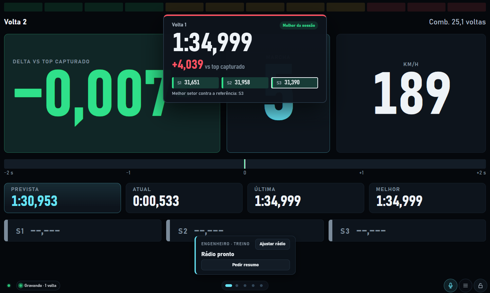
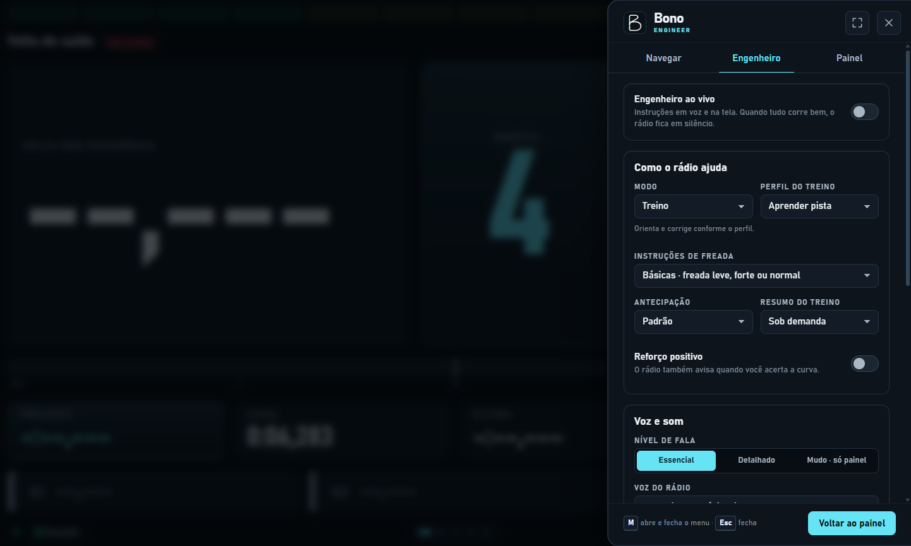
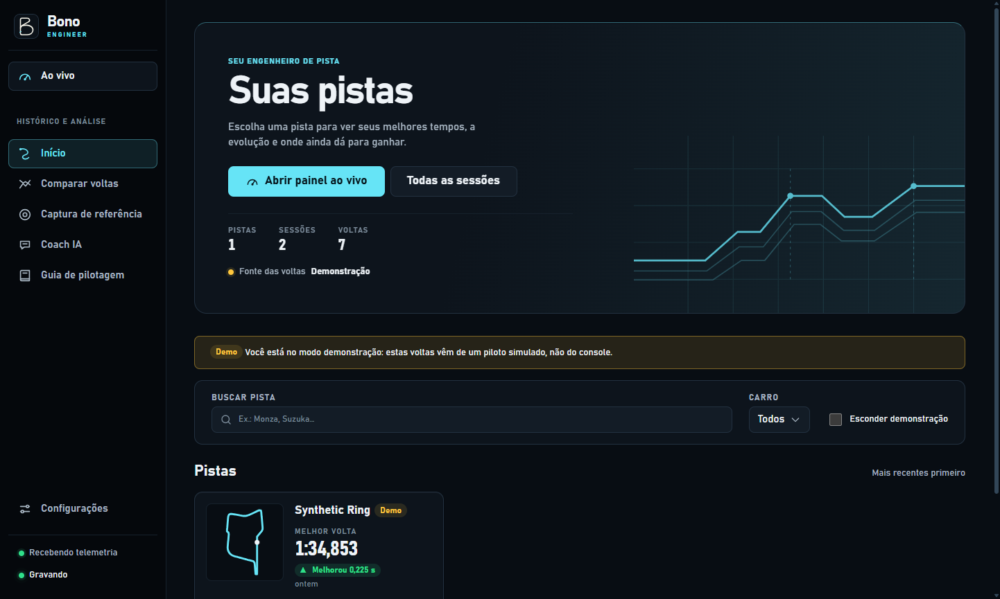
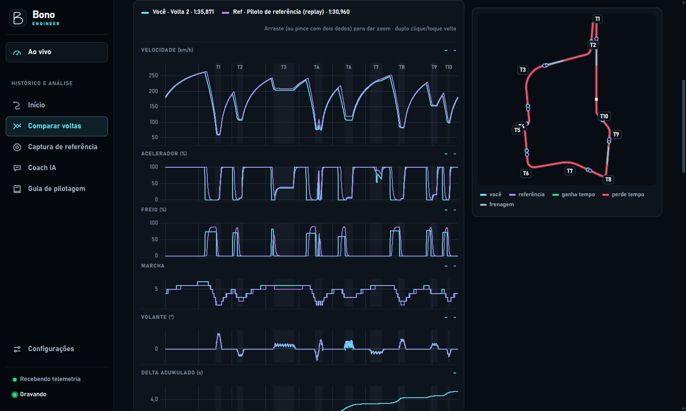

# Bono Engineer

[Português (Brasil)](docs/README.md) · [Download for Windows](https://github.com/lucassm02/bono-engineer/releases/latest) · [Changelog](CHANGELOG.md)

Bono Engineer is a race engineer for sim racing. Its current integration is **Gran Turismo 7 on PlayStation**. Run Bono on a computer to see live telemetry, hear coaching over the radio, and compare your laps after the session. A phone or tablet on the same network can act as a second dashboard.

Looking for GT7 telemetry, a race engineer for the PS5 or Discord radio for Gran Turismo 7? See the [Bono Engineer website](https://lucassm02.github.io/bono-engineer/) (in Portuguese, with an [English summary](https://lucassm02.github.io/bono-engineer/en/)).

## Screenshots

These screenshots show the Brazilian Portuguese interface with demo telemetry. In **Settings → Language**, choose Brazilian Portuguese, English or Spanish for the interface and radio.

| Live dashboard | Race radio |
| --- | --- |
|  |  |

| Track history | Lap comparison |
| --- | --- |
|  |  |

## What Bono does

### Live telemetry and dashboard

- Finds the PlayStation on the local network or connects to an IP you enter. It automatically selects a compatible GT7 packet format (A, B, `~`, or C) and reports connection and recording status.
- Shows speed, gear, revs and shift lights, driver inputs, tyre temperatures, fuel and estimated range when available, G forces, a track map, and lap and sector timing. The live delta can use your personal best, session best, or a captured reference.
- Offers 11 views: Race, Large Delta, Tyres, Inputs, Engine and Gearbox, Map, Times, Fuel, G Forces, Corner Training, and a customizable widget grid.
- Saves dashboard layout, start view, and screen order per device. Use keyboard or touch gestures, toggle the lap-finish card, lock the controls, or select an active screen for another device from the PC.
- Shares the dashboard via a LAN address or QR code. Use fullscreen on a supported browser or the native Windows app, or add the web dashboard to a phone or tablet home screen.

### Guided start and help

- A first-run assistant sets up the language and voice, the PS5 connection, the training style, the engineer and the dashboard layout, and resumes where you stopped. **Settings → About → Run the assistant again** reopens it.
- A guided tour of the live dashboard (on the built-in demo, so it needs neither a PS5 nor a car on track) and of the analysis area, plus one-time hints. Open **Help** in the menu for short guides by topic in Portuguese, English and Spanish. The tours can also start from a link: `?tour=live` or `?tour=analysis`.
- The live screen always shows a context bar with the track, the car and the engineer state. A three-step guide explains the recognition lap, and you can choose the track before the session starts so the engineer talks from lap 1.

### Race engineer and Discord

- **Training** offers Learn Track, Gain Time, Consistency, and Free Practice profiles. Learn Track can give a simple call such as “light braking in 100 metres” or a detailed call such as “50% brake in 100 metres” when a usable reference is available.
- **Qualifying** warns about cold tyres on the out-lap, stays quiet on the flying lap, and announces the result after the line. **Race** prioritizes tyre and fuel alerts when the telemetry supports them. Both modes can run without a reference lap.
- Choose Essential, Detailed, or Muted speech. Configure lap summaries, optional positive feedback, and the lead time for coaching. The radio button beside the live menu and lock shows or hides the radio card while leaving the audio output active.
- Choose from three built-in neural voices in each language (Voice 1, 2 and 3). The same call catalogue is available for local playback and Discord. Live coaching decisions come from telemetry rules and can be logged for replay and debugging.
- Send the radio calls to a **Discord voice channel** and hear them through your PS5 headset. A setup wizard creates the invite link and lists the voice channels; you only paste the token of your own bot (no user ID needed). The Windows app stores the token using Windows encryption. A ten-beep test measures the end-to-end delay, and Bono uses that delay and recent speed to schedule calls earlier. See the [Discord setup guide in Portuguese](docs/radio-discord.md).

### Sessions, references, and analysis

- Records sessions and complete laps automatically, including lap validity, sector times, and telemetry traces. Optional raw packet recording preserves `.gt7rec` files. Delete individual laps or sessions from history. The Windows app can keep recording from the notification area.
- Identifies cars and track layouts when telemetry matches the catalogs. Browse sessions and personal records by track and car, inspect the track map and sectors, and correct track or corner names when needed.
- Captures a reference from a GT7 replay, including your own lap or a leaderboard replay. Compare it with your best lap, set it as the live delta target, or use it to practise selected corners.
- Aligns laps by distance and overlays speed, brake, throttle, gear, steering when available, and time gain or loss. Review microsectors, braking and throttle points, driving events, line choice, corner metrics, an ideal lap, consistency, and progress over time.
- Export lap data as CSV or JSON, comparison charts as PNG, and raw recordings when enabled.
- Follow the **Daily Races** of the week (the three Sport Mode races) with their rules, medal times, top 100 and top 1000, and the time of 1st place, next to your own best lap on the same track. It is **off until you say yes** to a one-time question on Home; then Bono reads the public pages of [DG EDGE](https://www.dg-edge.com/events/dailies) from your PC, at most once an hour, honouring `robots.txt`, and links back to the source. No player names are stored. "Use as reference" opens the replay capture with the ranking time filled in.
- Choose where your data lives (for example a OneDrive or Dropbox folder, with a safer write mode there) and move it between PCs with **.bono backups**: export sessions, laps and settings (never keys or passwords), and import them to add to or replace your history.
- Browse the built-in driving guide or use **AI Coach** for a saved post-session debrief based on your telemetry and charts. The coach uses your Anthropic API key. Live telemetry and the race radio work without it.
- Connect external tools to the REST API, WebSocket feed, or MCP. The local MCP server exposes telemetry, lap comparisons, charts, and history over HTTP, with a stdio option for desktop clients.

## Get started

### Windows app

1. Download `Bono-Engineer-Setup-<version>.exe` for Windows x64 from [GitHub Releases](https://github.com/lucassm02/bono-engineer/releases/latest). Run it and launch Bono Engineer. Use `Bono-Engineer-<version>-portable.exe` to run without installing.
2. Connect the PC and PlayStation to the same local network. Allow Bono on private networks if Windows Firewall asks.
3. Follow the first-run assistant, then open GT7 and enter a track. In Bono, open **Live**. If discovery does not find the console, open **Settings → Console → Use another IP** (under advanced options) and enter the console IP.
4. On a phone or tablet, scan the QR code on Home or in **Settings → Live and devices → Open on a phone or tablet**, or open the LAN address shown there. Use landscape mode for the live dashboard.

The installer is unsigned, so Windows SmartScreen may show a warning. For an update, run the newer installer. Session data is stored separately from the application.

### Run from source

Requires **Node.js 24 or later** and npm. The Windows app bundles its runtime.

```sh
npm ci
npm run build
npm start
```

Bono serves the web app and API on `http://localhost:8770` by default. When the default port is busy, it reports the next available port. Use `npm run demo` to explore without a console, or `npm run dev` to work on the frontend with Vite.

| Task | Command |
| --- | --- |
| Type-check all workspaces | `npm run typecheck` |
| Run the tests | `npm test` |
| Run the Electron app in development | `npm run desktop` |
| Build Windows x64 installer and portable app | `npm run desktop:dist -- --publish never` |
| Run the MCP server over stdio | `npm run mcp` |
| Inspect console packets | `npm run sniff -- --ps-ip <console-ip>` |
| List server options | `npm start -- --help` |

### Local data and connectivity

- The app stores SQLite history, per-lap traces, reports, and recordings in `%APPDATA%\Bono Engineer` on Windows by default. In the Windows app you can pick another folder in **Settings → Accounts and data → Data folder** (OneDrive and similar folders are detected and use a safer write mode). From source it uses `~/Library/Application Support/Bono Engineer` on macOS and `${XDG_DATA_HOME:-~/.local/share}/bono-engineer` on Linux. Demo data lives in a separate `demo` subfolder. For a backup, use **Settings → Accounts and data → Export backup** (a `.bono` file; **Import backup** adds it to or replaces another installation), or close Bono and copy the data directory.
- Windows desktop settings and logs are under `%LOCALAPPDATA%\Bono Engineer`. **Settings → Accounts and data** shows the active data path and, under **Connect to Claude or Codex**, the commands for connecting MCP clients. The default HTTP endpoint is `http://localhost:8770/mcp`.
- GT7 sends telemetry to UDP **33740** and listens for heartbeats on UDP **33739**. The remote dashboard needs inbound TCP **8770**, or the actual port shown by Bono. See the [Windows firewall steps in Portuguese](docs/README.md#firewall-do-windows).
- If Bono is waiting for the game, enter a track and check that the PC and console are on the same subnet without guest-network isolation. Close other telemetry apps if UDP 33740 is in use.
- Available channels depend on the GT7 packet format, game mode, and car. For example, some replays lack steering data and some modes do not provide a meaningful fuel-consumption estimate.

## Releases and CI

[Windows build and release](.github/workflows/windows.yml) runs on pull requests to `main`, pushes to `main`, and manual runs. It installs locked dependencies, checks types, runs the tests, and saves both Windows x64 executables as a workflow artifact. On `main`, it publishes the first successful build for each version to [GitHub Releases](https://github.com/lucassm02/bono-engineer/releases), using the tag `v<version>` and the matching changelog entry as the release description.

For a new release, update `version` in the root and desktop `package.json` files, refresh `package-lock.json` with `npm install --package-lock-only`, and add a dated entry below **Unreleased** in [CHANGELOG.md](CHANGELOG.md). Update the version links at the bottom of the changelog. An entry can carry `<!-- release-notes-since: x.y.z -->` so the release description also lists every earlier version since `x.y.z`. The workflow verifies that the package versions and newest entry agree.

## More documentation

- [Discord on Windows and PS5](docs/radio-discord.md)
- [Driving guide and telemetry interpretation](docs/guia-de-pilotagem.md)
- [PS5 telemetry test checklist](docs/primeiro-teste-com-ps5.md)
- [REST API and WebSocket](packages/server/README.md) · [MCP tools](packages/mcp/README.md) · [GT7 protocol](packages/protocol/README.md)
- [Bono Engineer design system](docs/design-system.md)

## License

Bono Engineer is **source-available, not open source**. The code is published under the [PolyForm Noncommercial License 1.0.0](LICENSE): you may read, use, copy, change and share it for any noncommercial purpose (personal use, hobby projects, education, charities), keeping the license notice with every copy, but you may not use it commercially, for example inside a paid product or service. To use Bono commercially, contact the author. Contributions to this repository are welcome under the terms in [CONTRIBUTING.md](CONTRIBUTING.md).

Versions published up to 0.3.1 were released under the MIT License, and remain available under it to everyone who received them. Third-party resources retain their own terms. See the [voice credits](packages/web/public/radio/CREDITS.txt), [track catalog sources](packages/shared/src/tracks/data.ts), and [car catalog source](packages/shared/src/cars/data.ts).
