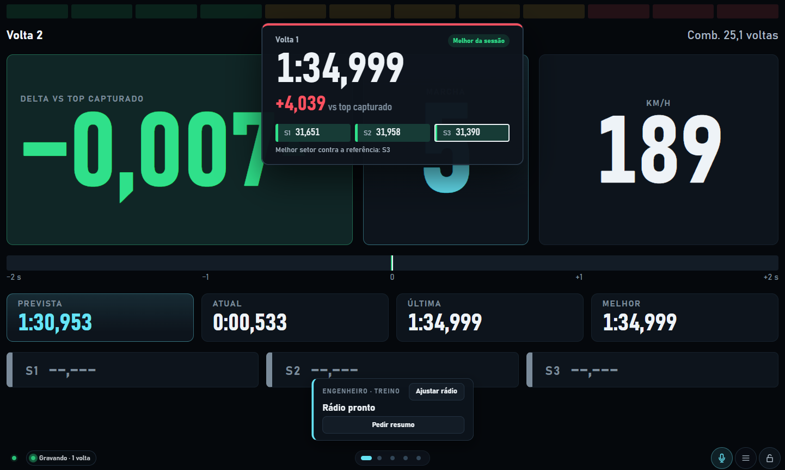
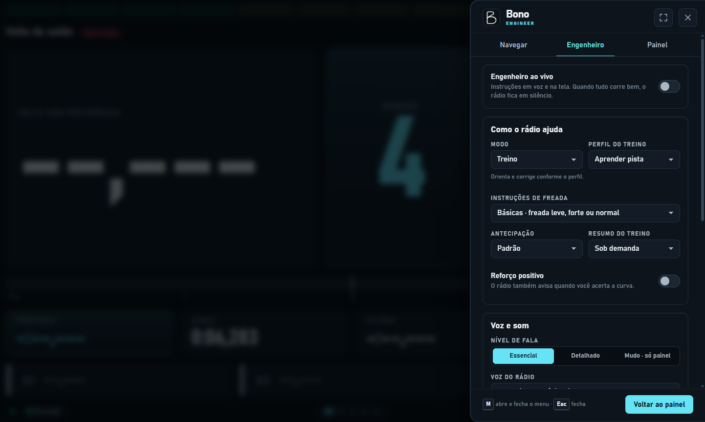
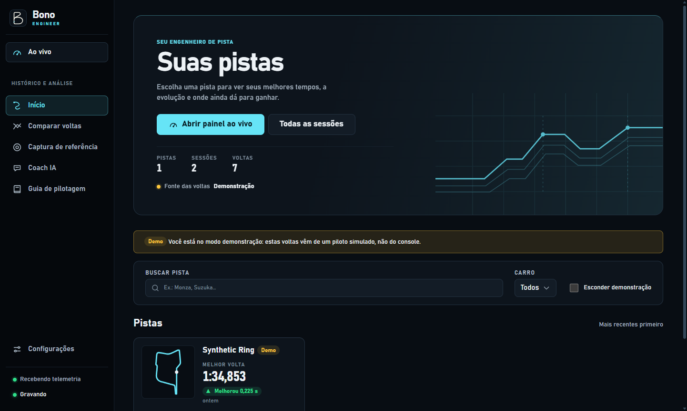
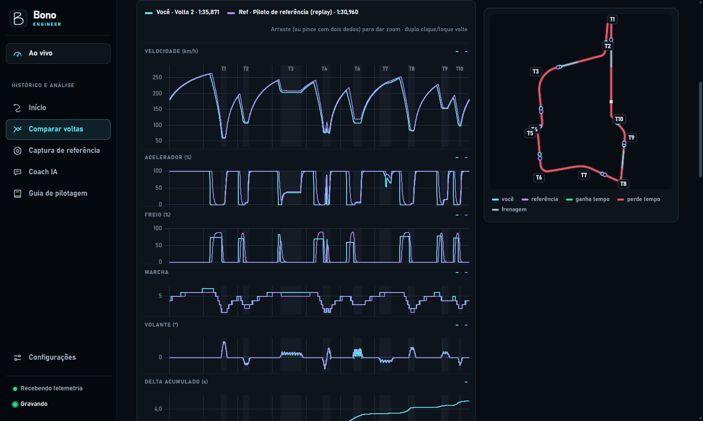

# Bono Engineer

[English](../README.md) · [Baixar para Windows](https://github.com/lucassm02/bono-engineer/releases/latest) · [Histórico de versões](../CHANGELOG.md)

O Bono Engineer é um engenheiro de pista para simuladores. A integração disponível hoje é com **Gran Turismo 7 no PlayStation**. Rode o Bono no computador para ver a telemetria em tempo real, ouvir o engenheiro e comparar suas voltas depois de pilotar. Um celular ou tablet na mesma rede pode servir de painel adicional.

## Capturas de tela

Capturas do aplicativo em português do Brasil, com telemetria de demonstração.

| Painel ao vivo | Engenheiro de rádio |
| --- | --- |
|  |  |

| Histórico por pista | Comparação de voltas |
| --- | --- |
|  |  |

## Funcionalidades

### Painel e telemetria ao vivo

- Encontra o PlayStation na rede local ou se conecta ao IP informado. Seleciona automaticamente um formato compatível do GT7 (A, B, `~` ou C) e mostra o estado da conexão e da gravação.
- Exibe velocidade, marcha, rotações e luzes de troca, comandos do piloto, temperaturas dos pneus, combustível e autonomia estimada quando disponíveis, forças G, mapa e tempos de volta e setores. O delta pode usar a melhor pessoal, a melhor da sessão ou uma referência capturada.
- Inclui 11 telas: Corrida, Delta grande, Pneus, Inputs, Motor e câmbio, Mapa, Tempos, Combustível, Forças G, Treino de curva e Personalizada, com uma grade de widgets.
- Guarda a tela inicial, a ordem e a configuração do painel por aparelho. Use gestos ou teclado, configure o cartão de fim de volta, trave os controles ou escolha pelo PC qual tela aparece em outro dispositivo.
- Compartilha o painel por endereço de rede ou QR code. Use tela cheia no navegador compatível ou no aplicativo Windows, ou adicione o painel à tela inicial do celular ou tablet.

### Engenheiro de rádio e Discord

- **Treino** tem os perfis Aprender pista, Ganhar tempo, Consistência e Livre. Com uma referência disponível, Aprender pista pode orientar no modo básico (“Freada leve em 100 metros”) ou detalhado (“50% de freio em 100 metros”).
- **Classificação** alerta sobre pneus frios na volta de preparação, fica em silêncio durante a volta rápida e informa o resultado depois da linha. **Corrida** prioriza alertas de pneus e combustível quando a telemetria permite. Ambos os modos funcionam sem volta de referência.
- Escolha o nível de fala Essencial, Detalhado ou Mudo. Configure o resumo de volta, o reforço positivo e a antecipação das chamadas. O botão de microfone ao lado do menu e do cadeado mostra ou oculta o cartão do rádio, mantendo a saída de áudio ativa.
- Selecione as vozes Alex, Santa ou Bruno, disponíveis em português do Brasil. O rádio ao vivo segue regras de telemetria e pode registrar as decisões para análise e reprodução.
- Envie as chamadas de Aprender pista para um **canal de voz do Discord** e ouça no headset do PS5. O app Windows usa o armazenamento seguro do sistema para criptografar o token. O teste com dez bipes mede o atraso até o headset, e o Bono usa o atraso e a velocidade recente para adiantar as chamadas. Veja o [guia de configuração do Discord](radio-discord.md).

### Sessões, referências e análise

- Grava sessões e voltas completas automaticamente, com validade, tempos por setor e traços de telemetria. É possível guardar os pacotes brutos em `.gt7rec` e excluir voltas ou sessões do histórico. No Windows, a gravação pode continuar com o Bono na bandeja.
- Identifica o carro e o traçado da pista quando os dados correspondem aos catálogos. Navegue pelas sessões e recordes por pista e carro, consulte o mapa e os setores e corrija nomes de pistas e curvas.
- Captura voltas de referência a partir de replays do GT7, incluindo a sua volta e replays do ranking. Compare a referência com seu melhor tempo, use-a para calcular o delta ou treine curvas selecionadas.
- Alinha voltas por distância e sobrepõe velocidade, freio, acelerador, marcha, direção quando disponível e ganho ou perda de tempo. Consulte microssetores, pontos de frenagem e aceleração, eventos, linhas, métricas de curva, volta ideal, consistência e evolução.
- Exporte os dados da volta em CSV ou JSON, gráficos de comparação em PNG e gravações brutas quando habilitadas.
- Consulte o **Guia de pilotagem** no app ou gere um relatório pós-sessão no **Coach IA**, que usa a telemetria, gráficos e uma chave da Anthropic fornecida por você. Telemetria e rádio funcionam independentemente do Coach.
- Conecte ferramentas externas pela API REST, pelo WebSocket ou pelo MCP. O servidor MCP local expõe telemetria, comparações, gráficos e histórico via HTTP, com opção stdio para clientes de desktop.

## Instalar e conectar

1. Baixe `Bono-Engineer-Setup-<versão>.exe` para Windows x64 em [GitHub Releases](https://github.com/lucassm02/bono-engineer/releases/latest) e abra o Bono Engineer. Para rodar sem instalar, baixe `Bono-Engineer-<versão>-portable.exe`.
2. Conecte computador e PlayStation à mesma rede local. Se o Firewall do Windows perguntar, permita o acesso nas redes privadas.
3. Siga o assistente de primeira execução, abra o GT7 e entre em uma pista. No Bono, abra **Ao vivo**. Se a busca automática não encontrar o console, informe o IP em **Configurações → Integração de telemetria → Usar outro IP**.
4. No celular ou tablet, escaneie o QR code em **Configurações → Dispositivo remoto** ou abra a URL de rede que aparece ali. Use o painel na horizontal.

O instalador é distribuído sem assinatura de código, então o SmartScreen pode exibir um aviso. Para atualizar, rode o instalador mais recente. As sessões ficam na pasta de dados do usuário.

### Usar o painel

| Controle | Ação |
| --- | --- |
| Deslizar ou usar `←` e `→` | Trocar de tela |
| Toque duplo ou `D` | Trocar a referência do delta |
| Segurar a tela ou apertar `Enter` | Abrir o seletor de telas |
| `M` | Abrir ou fechar o menu ao vivo |
| Cadeado ou `L` | Travar os gestos. No celular, segure o cadeado para destravar. |
| Microfone | Exibir ou ocultar o cartão do rádio quando o engenheiro estiver ativo |

Em **Configurações → Aparelhos conectados**, use **Mostrar tela** para selecionar uma tela habilitada em outro aparelho.

### Firewall do Windows

O GT7 envia dados para **UDP 33740** e recebe o heartbeat em **UDP 33739**. O acesso por celular ou tablet usa **TCP 8770** por padrão. Se o Bono indicar outra porta para o painel, use a porta indicada na regra TCP.

Se precisar liberar as portas manualmente, abra o PowerShell como administrador. Estas regras valem para o perfil de rede privada.

```powershell
New-NetFirewallRule -DisplayName 'Bono Engineer (telemetria GT7)' -Direction Inbound -Protocol UDP -LocalPort 33740 -Action Allow -Profile Private
New-NetFirewallRule -DisplayName 'Bono Engineer (painel remoto)' -Direction Inbound -Protocol TCP -LocalPort 8770 -Action Allow -Profile Private
```

### Solução de problemas

| Sintoma | O que conferir |
| --- | --- |
| Bono aguardando o jogo | Entre em uma pista no GT7. Confira a regra UDP, a sub-rede dos dois aparelhos e se há isolamento de clientes ou rede de convidados. Tente informar o IP do console. |
| Porta UDP já em uso | Feche a outra ferramenta de telemetria que está usando a porta 33740. |
| Celular não abre o painel | Abra o endereço mostrado pelo Bono e confira a rede privada, a regra TCP e a porta em uso. |
| Rádio no Discord pede para conferir canal e permissões | Confira o ID do canal de voz e as permissões **Ver canal**, **Conectar** e **Falar** para o bot naquele canal. Veja o [guia do Discord](radio-discord.md). |
| Dado ausente em um replay ou modo do GT7 | Os canais variam com o formato de pacote, o modo e o carro. Alguns replays não enviam direção, e alguns modos não fornecem consumo confiável de combustível. |

## Rodar a partir do código

Requer **Node.js 24 ou superior** e npm. O aplicativo Windows já inclui seu ambiente de execução.

```sh
npm ci
npm run build
npm start
```

O painel e a API ficam em `http://localhost:8770` por padrão. Quando a porta está ocupada, o Bono informa a próxima disponível. Use `npm run demo` para testar sem console ou `npm run dev` para desenvolver a interface com o Vite.

| Tarefa | Comando |
| --- | --- |
| Checar os tipos de todos os pacotes | `npm run typecheck` |
| Rodar os testes | `npm test` |
| Abrir o Electron em desenvolvimento | `npm run desktop` |
| Gerar o instalador e o portátil Windows x64 | `npm run desktop:dist -- --publish never` |
| Rodar o MCP via stdio | `npm run mcp` |
| Inspecionar pacotes do console | `npm run sniff -- --ps-ip <IP-do-console>` |
| Listar parâmetros do servidor | `npm start -- --help` |

### Dados e integração com IA

- O histórico SQLite, os traços, os relatórios e as gravações ficam em `%APPDATA%\Bono Engineer` no Windows. Ao rodar pelo código, a pasta no macOS é `~/Library/Application Support/Bono Engineer`. No Linux, é `$XDG_DATA_HOME/bono-engineer` ou `~/.local/share/bono-engineer`. A demonstração usa uma subpasta `demo`.
- Faça backup da pasta inteira com o Bono fechado. Para escolher outra pasta ao rodar pelo código, use `--data` ou `GT7_DATA`. Os logs e as preferências da janela Electron ficam em `%LOCALAPPDATA%\Bono Engineer`.
- Em **Configurações → Integração com IA**, confira a pasta ativa e copie os comandos para conectar clientes MCP. O endereço HTTP padrão é `http://localhost:8770/mcp`. A chave da Anthropic, se salva, fica no banco local.

## Releases e CI

O workflow [Windows build and release](../.github/workflows/windows.yml) roda em pull requests e pushes para `main` e também pode ser disparado manualmente. Ele instala as dependências do lockfile, checa os tipos, roda os testes e disponibiliza os dois executáveis Windows x64 como artefato. Em `main`, o primeiro build aprovado de cada versão é publicado no [GitHub Releases](https://github.com/lucassm02/bono-engineer/releases), com tag `v<versão>` e a entrada correspondente do changelog como descrição.

Para lançar uma versão, atualize `version` no `package.json` da raiz e no de `packages/desktop`, sincronize o lockfile com `npm install --package-lock-only` e adicione uma entrada datada abaixo de **Unreleased** no [CHANGELOG.md](../CHANGELOG.md). Atualize os links de versão no fim do changelog. O workflow verifica se as versões e a entrada mais recente conferem.

## Mais documentação

- [Configuração do Discord no Windows e no PS5](radio-discord.md)
- [Guia de pilotagem e interpretação da telemetria](guia-de-pilotagem.md)
- [Roteiro de teste da telemetria no PS5](primeiro-teste-com-ps5.md)
- [API REST e WebSocket](../packages/server/README.md) · [Ferramentas MCP](../packages/mcp/README.md) · [Protocolo do GT7](../packages/protocol/README.md)
- [Sistema visual do Bono Engineer](design-system.md)

## Licença

O Bono Engineer é distribuído sob a [licença MIT](../LICENSE). Recursos de terceiros mantêm suas licenças. Consulte os [créditos das vozes](../packages/web/public/radio/CREDITS.txt), as [fontes do catálogo de pistas](../packages/shared/src/tracks/data.ts) e a [fonte do catálogo de carros](../packages/shared/src/cars/data.ts).
